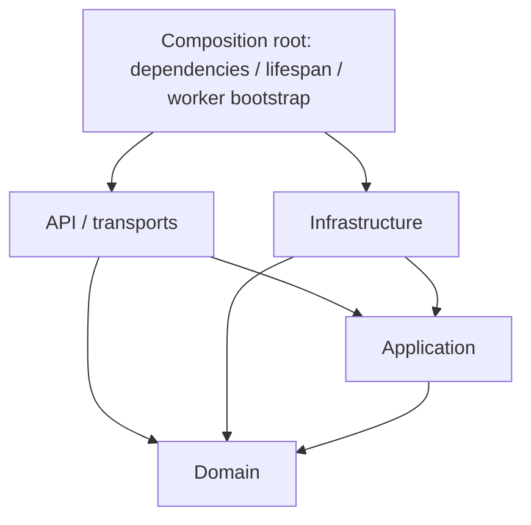
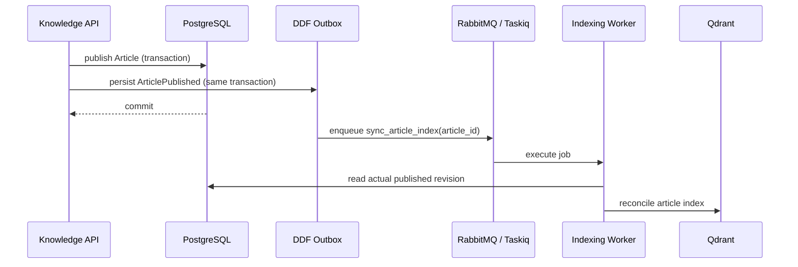
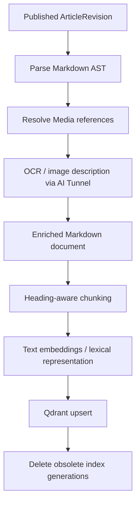
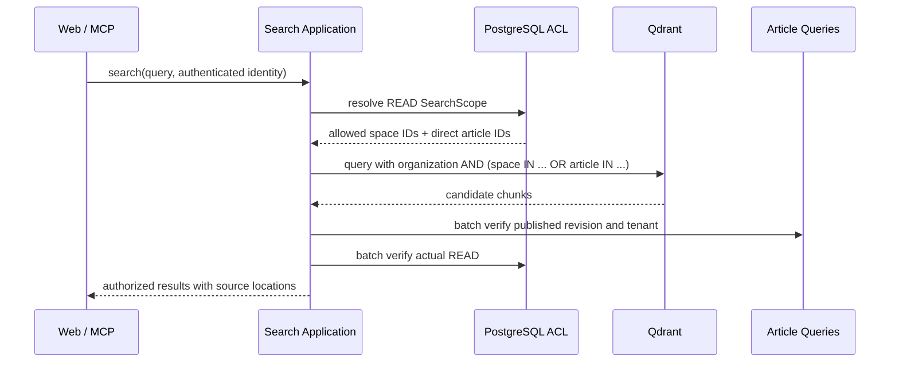

# Архитектура DIOS Knowledge Backend

> **Назначение документа.** Зафиксировать архитектурные границы, принятые решения и правила разработки backend базы знаний DIOS. Документ описывает целевую архитектуру; наличие компонента в схеме не означает, что он уже реализован.
>
> **Основной принцип:** бизнес-данные хранятся в PostgreSQL, файлы принадлежат Media Service, а Qdrant содержит восстанавливаемую поисковую проекцию опубликованных редакций.

## 1. Назначение и границы системы

**DIOS Knowledge** — самостоятельный сервис корпоративной базы знаний. Он управляет пространствами, коллекциями, статьями, редакциями, доступом к знаниям и поиском по опубликованному содержимому.

Сервис отвечает за:

- создание, редактирование, публикацию и архивирование статей;
- хранение истории редакций и навигационной структуры;
- ресурсные разрешения (`AccessGrant`) и проверку доступа;
- импорт документов в Markdown и экспорт в пользовательские форматы;
- построение и использование поискового индекса;
- предоставление знаний через пользовательское API и MCP.

**За пределами ответственности Knowledge:**

- пользователи, роли, членство и аутентификация — **DIOS IAM / Legacy IAM**;
- бинарные файлы, изображения и их жизненный цикл — **Media Service**;
- генерация ответа LLM и управление контекстом диалога — **DIOS AI Chat**;
- распознавание длительных аудио/видео — специализированные сервисы, когда такая интеграция появится.

Knowledge не зависит от бизнес-моделей ITSM и взаимодействует с другими подсистемами через явные API и события.

## 2. Стек технологий

| Назначение | Технологии |
|---|---|
| Язык и HTTP API | Python 3.14+, FastAPI, Pydantic v2 |
| Архитектурная основа | `py-ddd-framework` (DDF) |
| Транзакционные данные | PostgreSQL, SQLAlchemy 2.x, asyncpg |
| Поисковый индекс | Qdrant |
| Очереди и фоновые задания | RabbitMQ, Taskiq |
| Надёжная публикация событий | DDF Domain Events + Transactional Outbox |
| Кэш / вспомогательные механизмы | Redis — только при обоснованной необходимости |
| Медиа и вложения | DIOS Media Service |
| OCR / embeddings | AI Tunnel или совместимый провайдер через application ports |
| Интеграция с ИИ-чатами | MCP, реализованный как отдельный API transport |

## 3. Структура проекта

```text
src/
├── api/
│   ├── routers/
│   │   ├── admin/
│   │   ├── user/
│   │   ├── service/
│   │   └── mcp/
│   ├── dependencies/
│   ├── middlewares/
│   └── lifespan.py
├── application/
│   ├── auth/
│   ├── access/
│   ├── spaces/
│   ├── collections/
│   ├── articles/
│   └── search/
├── domain/
│   ├── access/
│   ├── spaces/
│   ├── collections/
│   └── articles/
└── infra/
    ├── database/
    ├── qdrant/
    ├── services/
    ├── broker/
```

Структура внутри модуля определяется его сложностью: не создаём пустые слои и файлы по шаблону. Для небольшого модуля достаточно `models.py`, `repositories.py`, `usecases.py`; разделяем их дальше по мере необходимости.

### 3.1. Правило зависимостей



- **`domain`** — не импортирует `application`, `api` или `infra`. Содержит бизнес-модели, инварианты, value objects, доменные события и чистую логику.
- **`application`** — оркестрирует сценарии, определяет порты (`Protocol`), DTO и транзакционные границы. Не зависит от FastAPI, SQLAlchemy, Qdrant и Taskiq.
- **`infra`** — реализует application ports, может импортировать `application` и `domain`. Содержит ORM, API-клиентов, broker adapters и worker entry points.
- **`api`** — преобразует транспортные запросы в вызовы application. Не размещает в роутерах SQL-запросы и бизнес-правила.
- **`api/dependencies`, `lifespan` и bootstrap worker** — **composition roots**: здесь допустимо и необходимо связывать application-контракты с инфраструктурными реализациями.

Код application не должен импортировать FastAPI `Depends`; фоновые процессы собирают те же зависимости без HTTP.

### 3.2. API-уровни

| Каталог | Назначение |
|---|---|
| `api/routers/user` | REST API для аутентифицированных пользователей и frontend |
| `api/routers/admin` | Администрирование, технические и операционные операции |
| `api/routers/service` | Взаимодействие сервис–сервис с отдельной аутентификацией |
| `api/routers/mcp` | MCP tools/resources для ИИ-агентов и чатов |

MCP — отдельный протокол взаимодействия, **не REST API**, хотя его HTTP endpoint может быть встроен в FastAPI-приложение. Различаются transport и правила аутентификации; бизнес-сценарии используются повторно.

## 4. Правила разработки и DDF

**DDF** предоставляет базовые модели, generic CRUD, repositories, Unit of Work, dispatcher событий и transactional outbox.

Правила:

1. **Сначала функция.** Простые use cases и domain logic реализуются функциями с явными keyword-only зависимостями. Application use cases *не являются pure functions*: они обращаются к репозиториям и управляют транзакцией.
2. **Классы — по необходимости.** Класс оправдан для aggregate/entity, клиента с состоянием/lifecycle, инфраструктурного адаптера или связанного workflow. Не создаём `ArticleService` и `*Manager` только ради группировки функций.
3. **Generic CRUD — для простых операций.** DDF CRUD используется для стандартных мутаций с handlers/wrappers; публикация, работа с редакциями, перемещение элементов дерева и индексация остаются отдельными use cases.
4. **Нет контейнера зависимостей.** API использует FastAPI `Depends`, application принимает зависимости явно, worker создаёт их в своём lifecycle.
5. **Порты только на реальных границах.** Protocol полезен для repositories, внешнего media/AI API, embedding provider и поискового индекса; не вводим интерфейс ради единственной чистой функции.
6. **Один владелец транзакции.** Репозитории, DDF Dispatcher и UoW работают с одной PostgreSQL-транзакцией; commit происходит в согласованной application/API границе.
7. **Domain не выполняет I/O.** Aggregate меняет состояние и регистрирует события, а не вызывает RabbitMQ, Qdrant, IAM или HTTP.

Отдельные read queries могут использовать JOIN и проекции, не заставляя универсальные DDF repositories поддерживать произвольные graph-loading операции.

## 5. Доменная модель

### 5.1. Space

`Space` — независимая область знаний внутри организации, основная граница группировки и предоставления доступа.

- Принадлежит одной `organization_id`.
- Содержит статьи и коллекции.
- Используется для первоначального ограничения области поиска и управления разрешениями.

### 5.2. Collection и навигация

`Collection` содержит `organization_id` (денормализован, как у Article), `space_id`, `name`, `slug`, `description`.

Навигация моделируется отдельно через `CollectionPlacement`:

```text
CollectionPlacement
├── collection_id  # коллекция, куда помещён элемент
├── target         # Collection или Article
└── rank           # порядок элементов
```

Правила:

- Коллекция может иметь не более одного родителя и не может образовывать циклы.
- Статья может находиться в нескольких коллекциях одного Space.
- `rank` управляет порядком элементов; перемещение — отдельный application use case.
- **Навигационная иерархия не является иерархией доступа к содержимому статьи.** Добавление статьи в коллекцию само по себе не выдаёт `READ` на статью.

### 5.3. Article и ArticleRevision

`Article` — aggregate root, владеющий жизненным циклом и указателями на редакции:

```text
Article
├── organization_id
├── space_id
├── slug
├── current_revision_id
├── published_revision_id | None
├── revision_number
├── author_id
└── published_at | None

ArticleRevision
├── article_id
├── number
├── previous_revision_id | None
├── title
├── summary | None
├── content                 # Markdown
├── author_id
└── change_note | None
```

Редакции **неизменяемы после создания**. Редактирование создаёт следующую редакцию; восстановление исторической редакции также создаёт новую, а не переписывает старую.

- `current_revision_id` — версия в редакторе.
- `published_revision_id` — версия, доступная читателям и поиску.
- Черновые изменения опубликованной статьи не меняют публичный контент до следующей публикации.
- `publish`, `unpublish`, `revise`, `archive` выполняют инварианты доменной модели и регистрируют соответствующие события.
- Архивная статья не публикуется и не участвует в поиске. Для архива может использоваться DDF soft-delete при последовательной семантике восстановления.

### 5.4. Содержимое и медиа

**Markdown — единственный канонический редактируемый формат статьи.** Изображения и вложения хранятся в Media Service; Markdown содержит стабильные внутренние ссылки на них, а не временные signed URLs.

- Ссылки на другие статьи и ссылки на медиа — разные виды зависимостей.
- Опубликованная редакция должна ссылаться на **неизменяемую версию** вложения, иначе содержимое исторической Revision сможет измениться без новой редакции.
- HTML/Markdown рендерится с sanitization и политикой разрешённых ссылок.
- Импорт DOCX/PDF и преобразование в Markdown выполняется на backend; frontend показывает preview и позволяет исправить результат до сохранения.
- Экспорт Markdown → PDF/DOCX — отдельный use case с проверкой права на выбранную редакцию.

## 6. Авторизация и Access

IAM отвечает за **identity, роли и членство**, Knowledge — за **разрешения на собственные ресурсы**.

```text
AccessGrant
├── organization_id
├── resource: Resource(type: str, id: UUID)
├── subject: Subject(type: str, id: str)
└── permissions: Permission(IntFlag)
```

`Permission` включает `READ`, `WRITE`, `PUBLISH`, `ARCHIVE`. Назначения **allow-only**: подходящие grants объединяются побитовым `OR`.

Примеры `Subject`: `organization`, `user`, `role`; `group` и service principals добавляются, когда IAM сможет достоверно разрешать соответствующее членство. Legacy IAM использует строковые коды ролей, поэтому `Subject.id` может быть строкой; она должна быть стабильной и интерпретироваться в контексте организации.

- `build_subjects_from_auth(auth)` — **application adapter** от доверенного `AuthUser` к множеству субъектов.
- Generic `ensure_access(auth, resources, required, *, grant_repository)` проверяет разрешения.
- Модули `articles`, `spaces` и `collections` определяют **набор ресурсов** для проверки; Access не импортирует их бизнес-модели.
- Чтение Article учитывает grants на `Space` и на саму `Article`.
- Доступ к Collection может учитывать Space и цепочку родительских Collections; он **не даёт автоматически доступ к содержимому размещённых Articles**.
- Управление grants защищается отдельным полномочием IAM и валидацией существования ресурса, организации и subject.
- Для пары `(organization, resource, subject)` действует уникальность. Изменение маски через CRUD должно исключать дубликаты и конкурентные конфликты.

**Ограничение текущей модели:** `READ` на Space нельзя отменить локальным grant на Article. Поэтому конфиденциальные статьи размещаются в отдельных закрытых Spaces. Если нужны приватные статьи внутри открытого Space, вводится явная политика прерывания наследования; она не имитируется проверкой в одном endpoint.

Пока Legacy IAM не поддерживает multi-tenancy, используется временная организация-заглушка. При внедрении нового IAM её необходимо мигрировать; она **не является полноценной tenant isolation**.

## 7. Сценарии статей и API

| Операция | Права | Результат |
|---|---|---|
| `create_article` | `WRITE` на Space | Article + Revision №1, одна транзакция |
| `revise_article` | `WRITE` на Article | Новая immutable Revision |
| `publish_article` | `PUBLISH` на Article | Переключение `published_revision_id`, событие |
| `unpublish_article` | `PUBLISH` на Article | Снятие публикации, событие |
| `restore_article_revision` | `WRITE` на Article | Новая Revision из исторической |
| `archive_article` | `ARCHIVE` на Article | Архив + событие удаления из индекса |
| `get_current_article` | `WRITE` (редактор) | Article + current Revision |
| `get_published_article` | `READ` | Только опубликованная Revision |

Изменяющие сценарии используют загрузку Article с блокировкой либо эквивалентный optimistic concurrency control. Публикация проверяет `revision_id == current_revision_id`, чтобы не публиковать незнакомые редактору изменения. Несовпадение — `409 Conflict`.

Чтение Article вместе с нужной Revision выполняется специализированным `ArticleQueryRepository` через один SQL JOIN, если это полезно для read path; универсальный репозиторий агрегата не расширяется произвольными JOIN.

Предлагаемый пользовательский API (префикс `/api/user/v1`):

```http
POST   /spaces/{spaceId}/articles
GET    /articles/{articleId}/draft
POST   /articles/{articleId}/revisions
GET    /articles/{articleId}/revisions
GET    /articles/{articleId}/revisions/{revisionId}
POST   /articles/{articleId}/revisions/{revisionId}/restore
POST   /articles/{articleId}/publish
POST   /articles/{articleId}/unpublish
DELETE /articles/{articleId}
POST   /articles/{articleId}/restore
GET    /spaces/{spaceId}/articles/{slug}
POST   /search
```

Если `spaceId` передаётся в URL создания, он не должен дублироваться в теле запроса. Публикация возвращает успешное состояние Article после PostgreSQL commit; готовность поискового индекса — **асинхронная и отдельная**.

## 8. Domain Events и доставка

События отражают **бизнес-факты**, а не команды определённой базе данных:

- `ArticlePublished(article_id, organization_id, revision_id)`;
- `ArticleUnpublished(article_id, organization_id)`;
- `ArticleArchived(article_id, organization_id)`.

Изменение черновика не запускает индексирование, пока новая редакция не опубликована.



Обязательные свойства:

- Обновление Article и запись Outbox происходят **в одной транзакции**.
- Outbox processor подтверждает событие только после надёжной публикации задания.
- Если Outbox публикует обычные event envelopes, нужен тонкий consumer adapter; **обычный JSON доменного события нельзя напрямую класть в Taskiq task queue**.
- Worker допускает повторную доставку, retry/backoff и идемпотентное выполнение.
- Фоновая индексация не вызывается из `Article.publish()` или HTTP route.
- Для Taskiq используется отдельная фабрика зависимостей; FastAPI `Depends` в worker не применяется.

Temporal пока не нужен: индексация Markdown и OCR изображений не требует долговременного многошагового workflow. Сложные медиа-процессы могут быть делегированы специализированным сервисам.

## 9. Поисковая проекция и индексация

Qdrant не хранит бизнес-истину и может быть полностью восстановлен из опубликованных редакций и доступных медиа.

### 9.1. Конвейер



- Разбиение учитывает заголовки, списки, таблицы, блоки кода и токенные ограничения; в текст чанка добавляется контекст заголовков.
- OCR/vision применяется только к поддерживаемым изображениям; результат обогащает соседний смысловой блок, не изменяя исходную Revision.
- OCR-результаты кешируются по `media_id` + версии экстрактора (вложения неизменяемы по id); embeddings неизменившихся фрагментов переиспользуются по `content_hash`.
- Аудио, видео и Knowledge Graph **вне MVP**.
- Для высококачественного русского поиска целевое направление — dense + lexical/sparse retrieval и reranking после проверки прав. В MVP допустимо начать с dense и измерить качество.

### 9.2. Application contracts

Минимальные поисковые модели:

```text
SearchChunk:
  id, organization_id, space_id, article_id, revision_id,
  text, heading_path, position, media_ids

SearchScope:
  space_ids, article_ids

SearchHit:
  article_id, revision_id, chunk_id, score, text, heading_path
```

Основные внешние порты:

- `SearchChunkRepository` — сохранять/удалять chunks статьи и искать по **готовой области доступа**; реализация `QdrantSearchChunkRepository`.
- `TextEmbedder` — `embed_documents()` и `embed_query()`; реализация через AI Tunnel/совместимый API.
- `ImageTextExtractor` — OCR и краткое поисковое описание изображения одним вызовом vision-модели.

Протоколы располагаются в `application/search`, реализации — в `infra/qdrant` и `infra/ai`. `QdrantSearchChunkRepository` не читает Article из PostgreSQL и не генерирует dense-embeddings (BM25 считается сервером Qdrant). Подробности — [`docs/architecture/search.md`](../docs/architecture/search.md).

### 9.3. Payload Qdrant

В индексированных точках хранятся:

```text
organization_id
space_id
article_id
revision_id
chunk_id
position
heading_path
media_ids
text
```

Обязательные индексы фильтрации: `organization_id`, `space_id`, `article_id` (по мере необходимости — `revision_id`). Point IDs детерминированы относительно Revision, версии конвейера и позиции chunk.

Поколение индекса задаётся именем коллекции (`kb_chunks_g{N}`). При смене несовместимой embedding-модели или парсера создаётся новая Qdrant collection и выполняется переиндексация (reconcile); переключение по alias — следующий шаг.

### 9.4. Согласованность и удаление

`sync_article_index(article_id)` **сверяет текущее состояние PostgreSQL**, а не слепо исполняет содержимое старого события:

- Published → подготовить и индексировать текущую `published_revision_id`.
- Unpublished / Archived → удалить points статьи из Qdrant.
- Изменение черновика → индекс опубликованной редакции остаётся прежним.

Во время длительного OCR/embedding состояние статьи может измениться. Перед финальной записью worker перечитывает актуальную Revision и использует сериализацию обновления одной статьи (например, PostgreSQL advisory lock). Запись в Qdrant и PostgreSQL не является единой транзакцией; необходимы retries, идемпотентность, periodic reconciliation и финальная проверка прав при поиске.

**Требование безопасности:** после unpublish публичное содержимое становится недоступным немедленно по данным PostgreSQL, даже если физическое удаление Qdrant ещё не закончено.

## 10. Безопасный поиск

**Права вычисляются до обращения к Qdrant.** Поиск по всему индексу с последующим отбрасыванием запрещённых результатов не используется как основной алгоритм.



`SearchScope` представляет **разрешённую область поиска**, а не копию `AuthUser` или общий «контекст» приложения. При текущем additive ACL он содержит:

- `space_ids`, на которые у пользователя есть `READ`;
- `article_ids`, на которые есть прямой `READ`.

Qdrant filter обязательно включает tenant и условие `(space IN allowed_spaces OR article IN allowed_articles)`. **Пустой scope возвращает пустой результат без запроса к Qdrant.**

После получения кандидатов application выполняет пакетную проверку:

1. Article принадлежит нужной организации.
2. Она не архивирована и действительно опубликована.
3. `revision_id` найденного чанка равен актуальной `published_revision_id`.
4. У вызывающего субъекта всё ещё есть `READ`.

**Ни snippets, ни excerpts, ни текст для внешнего reranker/LLM не возвращаются до этой проверки.** При многочисленных недоступных кандидатах используется overfetch и при необходимости повторная выборка. Коллекции не расширяют ACL содержимого статей.

## 11. MCP и интеграция с DIOS AI Chat

MCP — тонкий транспортный адаптер к тем же application use cases, что и Web API:

- `search_knowledge(query, limit)` — безопасный поиск и источники;
- `get_knowledge_article(article_id)` — чтение только разрешённой опубликованной редакции.

AI Chat не обращается к Qdrant напрямую и не может передавать произвольные `user_id` или `organization_id` в аргументах инструмента для выбора чужих прав. Knowledge получает доверенную пользовательскую identity (delegation/on-behalf-of) либо явно ограниченную service identity; сервисная аутентификация не означает автоматический bypass пользовательского ACL.

MCP возвращает идентификаторы статей, фрагменты и канонические ссылки на источники. Генерация LLM-ответа и цитирование на уровне диалога принадлежат AI Chat.

## 12. Транзакции, ограничения и ошибки

- В PostgreSQL задаются уникальные индексы для `(space_id, slug)` и для активного `(organization_id, resource, subject)` в grants.
- Уникальность обеспечивается БД, а не предварительным `SELECT`; SQL constraint violations преобразуются в понятные application errors (`409 Conflict`).
- Команды с конкурентным изменением Article используют row locking и/или optimistic concurrency (`expected_revision_id`).
- Предотвращение циклов и нарушения единственного родителя Collection должно учитывать конкурентные перемещения, а не только проверку в памяти.
- Безопасность tenant проверяется до изменения бизнес-состояния; доступ к чужому ресурсу может маскироваться как `404`.
- Outbox обеспечивает *at-least-once* доставку; consumers и операции над индексом проектируются идемпотентными.
- Не передаём API ключи, JWT и signed media URLs в domain events или Qdrant payload.

## 13. Тестирование и наблюдаемость

### Тестирование

- **Unit:** инварианты Article/Revision, CollectionPlacement, pure access/checking logic, Markdown chunking.
- **Application:** use cases с fake repositories и dispatcher; отдельные сценарии отказа в доступе и tenant isolation.
- **Integration:** PostgreSQL constraints, UoW/outbox атомарность, `SELECT FOR UPDATE`, Qdrant фильтры, повторная индексация и удаление.
- **Concurrency:** `publish → unpublish`, устаревшие события, параллельные worker, повторная доставка, гонки перемещения коллекций.
- **Security:** отсутствие snippets недоступных статей в Web/MCP/AI и мгновенная недоступность после unpublish.
- **Search relevance:** корпус реальных русскоязычных вопросов; Recall@K, nDCG@K, точность источника, p95 latency.

### Наблюдаемость

- Correlation ID проходит от API до domain event, outbox и фоновой задачи.
- Логируем ID статьи/редакции, этап pipeline, длительность, количество chunks, модель и версию индекса; **не логируем конфиденциальный текст и embeddings**.
- Метрики: lag outbox, число failed jobs, время OCR/embedding/Qdrant, доля неактуальных индексов, search p95 и ACL-filtered candidates.
- Возможность административно запустить переиндексацию статьи и полную reconciliation.

## 14. Осознанно отложенные решения

- Ограничительные ACL / прекращение наследования доступа внутри открытого Space.
- Группы и scopes нового DIOS IAM, migration от Legacy IAM.
- Аудио/видео индексация и долгоживущие multimedia workflows.
- Knowledge Graph / GraphRAG.
- Отдельная search ACL projection при слишком большом числе direct Article grants.
- Визуальные embeddings, page-level multivectors и дополнительные rerankers.
- Temporal и отдельный search microservice.

Новые абстракции вводятся при появлении **конкретного сценария, проверяемого инварианта или технологической границы**, а не ради симметрии каталогов.
