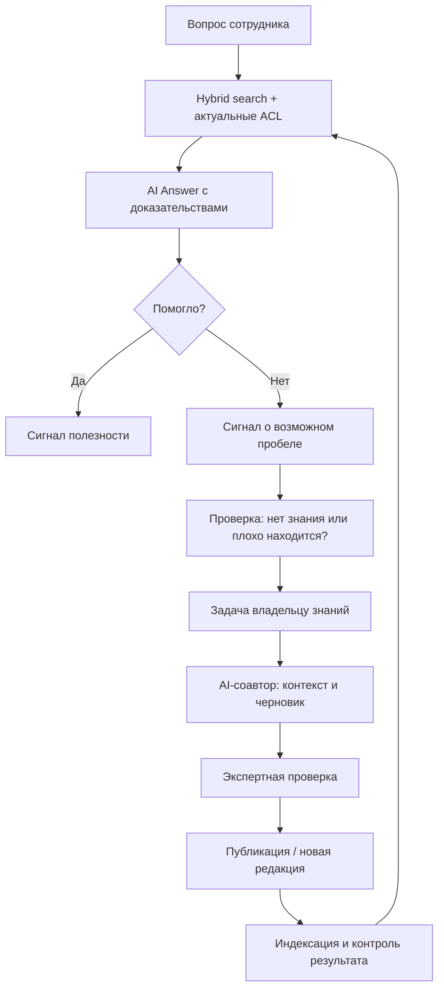

# DIOS KB — AI Answers & Knowledge Intelligence

**Статус:** проектная концепция / RFC, не описание уже реализованного функционала.  
**Дата:** 21 ноября 2026 г.  
**Контекст:** экосистема DIOS: Knowledge Base (KB), DIO Desk, AI Chats, Communications, IAM.

## Для чего этот пакет

Спроектировать AI Answers как встроенный в DIOS KB способ получить **проверяемое решение задачи на основе доступных корпоративных знаний**, а не ещё один чат. Развить обратную связь от неотвеченных вопросов до управляемого пополнения и улучшения базы знаний.

## Документы

1. **[01_PRODUCT_VISION.md](../../../../../../Downloads/01_PRODUCT_VISION.md)** — бизнес-концепция, аудитория, боли, ценность, позиционирование, эффект и метрики.
2. **[02_UX_AND_FEATURES.md](../../../../../../Downloads/02_UX_AND_FEATURES.md)** — сценарии, UX поиска и ответа, источники, ошибки, мобильная версия, требования к MVP и roadmap.
3. **[03_TECHNICAL_ARCHITECTURE.md](../../../../../../Downloads/03_TECHNICAL_ARCHITECTURE.md)** — RAG-пайплайн, контракты, ACL, цитаты, интеграция с API и AI Chats, тестирование и observability.
4. **[04_KNOWLEDGE_GAPS_AND_AI_AUTHORING.md](../../../../../../Downloads/04_KNOWLEDGE_GAPS_AND_AI_AUTHORING.md)** — выявление пробелов, уточняющее интервью, AI-соавтор инструкций, управляемый интернет-поиск, утверждение и постоянное улучшение знаний.
5. **[05_COMPETITIVE_RESEARCH.md](../../../../../../Downloads/05_COMPETITIVE_RESEARCH.md)** — разбор актуальных возможностей конкурентов и гипотезы дифференциации DIOS со ссылками на официальные материалы.

## Принятые принципиальные решения

| Вопрос | Направление |
|---|---|
| Что такое AI Answers? | Ответ внутри поиска KB, а не отдельный диалоговый продукт |
| Какой RAG? | Один hybrid retrieval + ACL + контекст + один LLM-вызов, без agent loop для MVP |
| Нужно ли MCP внутри AI Answers? | Нет; MCP — внешний интерфейс KB для AI Chats и других клиентов |
| Как обеспечивается доверие? | Фактические источники, привязка цитат к фрагментам, явное указание ограничений |
| Как улучшать знания? | Feedback → группировка проблем → проверка существующих знаний → задача редактору → AI-черновик → экспертная публикация |
| Должен ли AI писать инструкции? | Да, как *соавтор черновика*, с вопросами и доказательствами; без автоматической публикации |
| Нужен ли интернет? | Не в базовом Answer; опционален для подготовительного исследования по явному разрешению и изолированной политике |
| Где конкурентное преимущество? | Связь проблемы, подтверждённого решения, источников, заявок и жизненного цикла знаний |

## Сквозной сценарий

## Как читать

- Для руководителей и product/discovery — `01`, затем `02` и `05`.
- Для frontend и дизайна — `02`, затем `04`.
- Для backend/AI — `03`, затем `04`.
- Для обсуждения продукта Knowledge Intelligence — `04` и `05`.

**Оговорка:** количественные значения в документах (например, лимиты, пороги и целевые метрики) — стартовые гипотезы для экспериментов, а не измеренные результаты DIOS.
