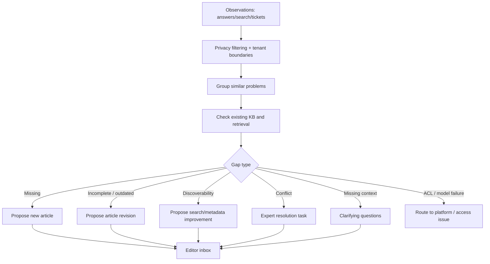
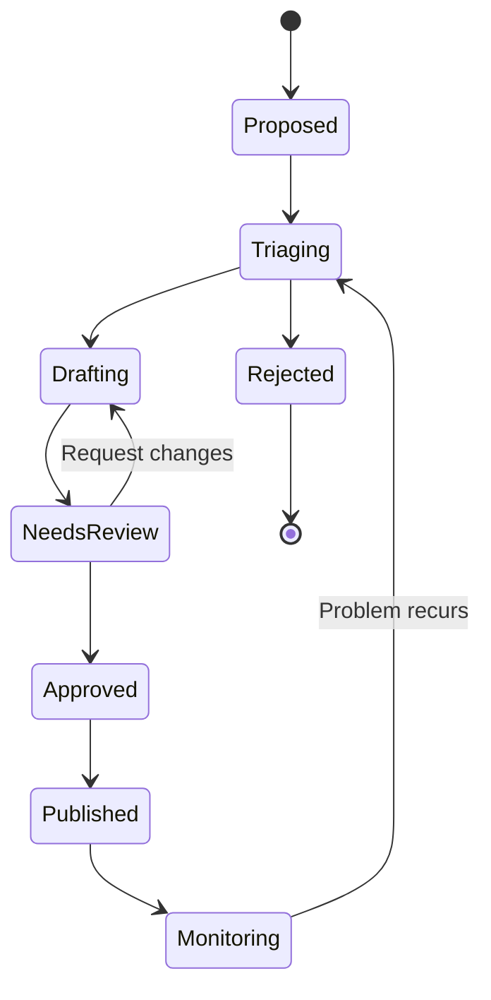
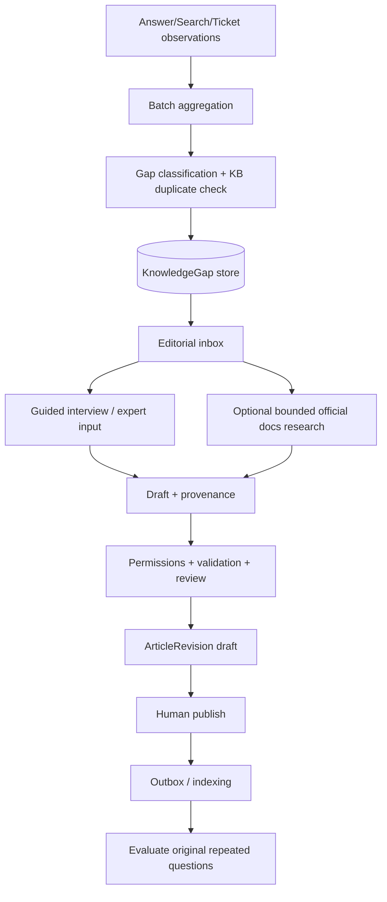

# DIOS Knowledge Intelligence — обнаружение пробелов и AI-соавтор знаний

**Статус:** отдельная продуктово-архитектурная концепция / расширение AI Answers.  
**Ключевая идея:** AI не просто отвечает по существующим знаниям, но помогает организации обнаруживать, собирать и проверять отсутствующие знания.  
**Дата:** 21 ноября 2026 г.

## 1. Executive decision

**Да, AI должен помогать создавать и улучшать инструкции.** Но в правильной модели он выступает **редактором-исследователем и интервьюером эксперта**, а не автономным автором «истины».

Предлагаемая функция — **Knowledge Gap → Guided Knowledge Capture → Reviewed Draft**:

1. DIOS выявляет повторяющуюся проблему или слабое место документации.
2. Определяет, что именно произошло: отсутствует знание, оно плохо находится, неполно, устарело или противоречит другим источникам.
3. Предлагает конкретное действие: улучшить поиск, обновить статью, создать статью либо запросить эксперта.
4. На основе разрешённых материалов готовит основу черновика.
5. **Если критичных сведений нет, AI задаёт целевые вопросы** человеку, который действительно знает предмет.
6. При необходимости предлагает **ограниченное исследование официальной внешней документации**, но только по разрешению и с разделением внешних сведений и внутренних фактов.
7. Готовит проверяемый черновик с provenance, пометками неопределённости и условиями применимости.
8. Эксперт проверяет и публикует обычную редакцию DIOS KB.
9. После индексации DIOS наблюдает, улучшилось ли разрешение исходной группы вопросов.

**Автоматическая публикация LLM-черновиков — не входит в базовую концепцию.**

## 2. Почему это важно

Обычные знания растут по инициативе авторов: кто-то должен заметить отсутствие инструкции, найти время и описать решение.

Здесь предлагается **demand-driven knowledge management**: контент улучшается в ответ на фактическую потребность, наблюдаемую по вопросам и работе.

Это близко к подходу Knowledge-Centered Service (KCS): повторно использовать знания, улучшать их в процессе работы, фиксировать контекст проблемы и структурировать материал для дальнейшего применения. См. [официальные практики KCS](https://library.serviceinnovation.org/KCS/Knowledge-Centered_Success_Practices_Guide/402-Purpose_Behind_the_Practices).

### Бизнес-результат

- Меньше повторной диагностики одних и тех же ошибок.
- Быстрее превращение редкого опыта эксперта в доступную инструкцию.
- Меньше ненужных дублирующихся статей.
- Контролируемое качество, не требующее читать весь массив KB вручную.
- Прямая аналитика «какие знания нужны людям и что мешает решить задачу».
- Возможность доказать пользу улучшенной статьи на тех же вопросах, которые породили запрос.

## 3. Очень важное различие: не каждый плохой ответ означает отсутствие знания

### Таксономия проблем

| Тип | Что произошло | Рекомендуемое действие |
|---|---|---|
| `missing_content` | Нет релевантной инструкции | Предложить новую статью |
| `incomplete_content` | Статья есть, но не описывает необходимое условие/шаг | Дополнить существующую редакцию |
| `discoverability` | Статья есть, но поиск её плохо находит | Исправить заголовок, синонимы, структуру, индексацию или retrieval |
| `outdated_content` | Знание относится к старой версии/процедуре | Назначить проверку актуальности |
| `conflicting_content` | Статьи рекомендуют несовместимые действия | Уточнить условия, назначить эксперту reconciliation |
| `missing_context` | Пользователь не указал версию, окружение или симптом | Спросить конкретное уточнение |
| `insufficient_authorization` | Пользователь не видит нужный документ | Не раскрывать чужие материалы; предложить разрешённый путь эскалации |
| `retrieval_failure` | Данные есть, но retrieval выбрал плохие кандидаты | Исправить search/ranking, а не писать новую статью |
| `generation_failure` | Источники достаточны, но LLM неверно сформулировал ответ | Исправить prompt/evidence selection/evals |
| `unverified_resolution` | Предполагаемое решение никто не подтвердил | Сначала подтвердить его, затем документировать |

**Принцип:** создание новой статьи — не fallback для каждой неудачной генерации.

### Пример

Пользователи часто спрашивают «Не работает авторизация HTTP-сервиса 1С».

Причины повторения могут быть разными:

- действительно отсутствует инструкция по конкретной ошибке;
- она называется «Настройка аутентификации IIS» и плохо находится по слову «401»;
- в документации не указана версия 1С или режим публикации;
- две статьи описывают разные схемы аутентификации, но это не обозначено;
- статья доступна только инженерам, а спрашивает пользователь без READ;
- модель неверно соединяет два найденных фрагмента.

Инструмент должен различать эти причины, иначе вместо решения проблемы база знаний просто разрастётся.

## 4. Откуда поступают сигналы

| Источник | Сигнал | Ограничение |
|---|---|---|
| AI Answers | `insufficient_evidence`, `conflicting_evidence`, негативный feedback | Не доказательство реального пробела |
| Обычный поиск KB | Частые запросы без переходов / без результата | Не всегда означает отсутствие знания |
| DIO Desk | Повторные обращения похожего типа, подтверждённые решения | Только разрешённые/санитизированные данные |
| Knowledge editor | Ручная отметка «устарело/ошибка/неполно» | Высокий приоритет, но требует проверки |
| DIOS AI Chats | Вопросы, по которым KB MCP не помог | Только при разрешённой аналитике и согласованной политике хранения |
| DIOS Communications | Подтверждённое решение, озвученное на встрече/звонке | Нельзя превращать сырую транскрипцию в проверенный факт |

**Не собирать все беседы и заявки «на всякий случай».** Для каждой категории нужен понятный purpose, tenant isolation, retention и ограничение прав доступа.

## 5. Detection pipeline



### 5.1. Сбор observations

Минимальные поля для событий: `organization_id`, `interaction_id`, `kind`, coarse topic/category, timestamp, resource references, outcome, feedback reason; исходный текст — опционален и требует отдельной политики. Для технических ошибок может быть полезно хранить **санитизированный fingerprint** симптома (например, код ошибки + версия + продукт), не сохранять реквизиты, URL с токенами, персональные данные и секреты.

### 5.2. Группировка повторяющихся проблем

Использовать нормализацию кодов ошибок и названий продуктов плюс семантическое сходство.

**Не схлопывать в один gap разные условия:** HTTP 401 при Windows Authentication, basic auth и при другом reverse proxy могут иметь разные исправления. Векторная близость — сигнал группировки, а не окончательное доказательство идентичности причины.

Можно начать с nightly/weekly batch без постоянного online-кластера. Важно ограничить анализ одной организацией и доступной для соответствующего редактора областью.

### 5.3. Проверка перед созданием задачи

Перед пометкой `missing_content`:

1. Найти похожие заголовки в KB.
2. Выполнить hybrid search по нескольким нормализованным формулировкам.
3. Проверить наличие близкой опубликованной статьи, включая доступность редактору.
4. Отличить проблему search от отсутствующего факта.
5. Проверить, есть ли подтверждённое решение из разрешённых обращений.
6. Если причина всё ещё неясна — статус `needs_triage`, не «точно отсутствует».

### 5.4. Приоритизация

Рекомендуемые факторы: число **различных** затронутых пользователей/обращений, частота повторения, доля неуспешных исходов, потенциальный ущерб, критичность операции, наличие владельца знаний, возможность быстро подтвердить решение.

Не сводить приоритет только к количеству вопросов. Редкая, но критичная ошибка доступа может быть важнее частой просьбы объяснить термин.

Порог «3 пользователя за 7 дней» может быть полезной стартовой гипотезой для пилота, **но не общим правилом**. Для малых организаций нужны другие пороги и ручные сигналы.

## 6. Экран редактора: Knowledge Improvement Inbox

```text
┌────────────────────────────────────────────────────────────────────────────┐
│ Возможности улучшения знаний                            [Владелец] [Тип] │
├────────────────────────────────────────────────────────────────────────────┤
│ ВЫСОКИЙ ПРИОРИТЕТ                                                      │
│ HTTP 401 при подключении к 1С                                           │
│ Повторяется в обращениях · несколько неудачных ответов                   │
│ Причина: возможный пробел / неполная инструкция                          │
│ Ближайшие материалы: Настройка IIS, Права пользователя HTTP-сервиса      │
│ [Проверить источники] [Создать с AI] [Назначить эксперту] [Отклонить]     │
├────────────────────────────────────────────────────────────────────────────┤
│ СРЕДНИЙ ПРИОРИТЕТ                                                       │
│ Не удаётся найти «подключение REST API»                                  │
│ Причина: вероятная плохая находимость статьи                             │
│ [Улучшить название и ключевые термины]                                   │
└────────────────────────────────────────────────────────────────────────────┘
```

Ключевые поля карточки:

- формулировка проблемы понятным языком;
- тип проблемы и его обоснование;
- объём подтверждающих observation-сигналов;
- связанные статьи и зарегистрированные обращения, доступные данному редактору;
- что уже проверила система;
- рекомендуемое действие и предполагаемый ответственный;
- возможность «не проблема / дубликат / отложить / исправлено» с причиной.

Нельзя показывать редактору чужие закрытые заявки лишь потому, что тема совпадает с его пространством. Агрегированные метрики должны учитывать риск раскрытия маленьких групп.

## 7. Guided Knowledge Capture — AI-интервью эксперта

### Когда показывать

После выбора editor action «Создать статью», «Дополнить статью» или «Зафиксировать найденное решение», а не автоматически каждому пользователю, который получил плохой ответ.

**Эксперт должен понимать цель:** «Собрать подтверждённую инструкцию для повторяющейся ошибки», а не «поговорить с AI».

### Как строится интервью

1. AI читает **разрешённый** релевантный контекст и список уже установленных фактов.
2. Выделяет **критические пропуски**, без которых инструкция может оказаться неверной.
3. Задаёт 1–3 наиболее важных вопроса за один шаг.
4. Предлагает короткие варианты выбора для версии/платформы, когда они обоснованы; всегда допускает свободный ответ.
5. Принимает файлы, санитизированные логи, подтверждённые шаги; не требует секреты.
6. Повторяет только если действительно остались недостающие факты; позволяет «Не знаю» и «Оставить на проверку».
7. Отражает, что уже доказано, а что остаётся предположением.
8. Формирует черновик без ручного переписывания истории диалога.

### Пример диалога (условный кейс HTTP 401)

**AI:** «Нашёл несколько обращений с HTTP 401 и две статьи. Для инструкции не хватает трёх фактов: (1) какая версия платформы/конфигурации 1С использовалась, (2) какой способ аутентификации был настроен на IIS, (3) какое изменение *подтверждённо* устранило ошибку?»

**Эксперт:** «Платформа 8.3.x; в конкретной публикации был отключён нужный механизм аутентификации; после настройки и повторной проверки запрос заработал».

**AI:** «Зафиксировал это как подтверждение для данной конфигурации. Осталось уточнить, где именно была выполнена настройка и какие условия безопасности необходимо сохранить. Не присылайте пароли или access tokens».

**Результат:** черновик с понятными разделами и пометкой для непроверенных деталей, а не «универсальное решение для всех HTTP 401».

**Важно:** подтверждение словом эксперта — источник, но отличается от подтверждения результатом теста в конкретном окружении.

### Какие вопросы полезны для технических процедур

- Симптомы / точная ошибка и способ воспроизведения?
- Продукт, версия, окружение, компонент, направление интеграции?
- Что **точно** было проверено и какой результат получен?
- Какой шаг реально устранил проблему?
- Для каких конфигураций решение известно как применимое?
- Как проверить успех? Как безопасно откатить изменение?
- Когда не следует применять инструкцию и кому эскалировать?
- Есть ли журнал, задача или официальный источник, подтверждающий вывод?

Количество вопросов должно быть ограниченным. Цель — уменьшать нагрузку на эксперта, а не превращать документирование в длинный допрос.

## 8. AI-соавтор: что именно генерирует

**Рекомендуемый шаблон для troubleshooting-статьи:**

```markdown
# [Проблема / код ошибки]

## Симптомы
[Наблюдаемые признаки, с указанием источников]

## Условия применимости
[Продукт, версия, окружение, роли, ограничения]

## Причина
[Только подтверждённая; иначе «Возможные причины»]

## Диагностика
1. [Шаг с признаком ожидаемого результата]

## Решение
1. [Проверенное действие]

## Проверка результата
[Как доказать, что проблема устранена]

## Что делать, если не помогло
[Развилки / эскалация]

## Ограничения и риски
[Влияние на безопасность и другие системы]

## Источники и история проверки
[Внутренние и внешние подтверждения, ответственный]
```

LLM может адаптировать структуру под стандарт организации, а не навязывать всем статьям один шаблон. Для понятийной статьи, FAQ и политики требуются другие шаблоны.

### Строгие правила подготовки

- **Сначала искать дубликат**, затем решить `new article` vs `update existing revision`.
- Не создавать раздел «Решение» из неподтверждённой догадки.
- Не придумывать команды, пути файлов, ключи реестра, параметры конфигурации или версии.
- Отмечать незаполненные факты **внутри соответствующего раздела**, а не только одним предупреждением в конце.
- Сохранять связь каждого существенного фрагмента с его provenance.
- Отдельно показывать условия, при которых процедура **не** применима.
- Превращать разрозненную переписку в самостоятельную инструкцию, а не копировать внутренний диалог со всеми именами и ошибочными попытками.

## 9. Следует ли AI самостоятельно ходить в интернет?

### Решение: да, но как **опциональный режим исследования** для редактора, не как дефолтный инструмент создания внутренних знаний

**Зачем внешние источники могут пригодиться:**

- уточнить публичный синтаксис параметра или описанную производителем процедуру;
- проверить, в каких версиях действует документированное поведение;
- найти официальные release notes и security guidance;
- сопоставить внутреннюю инструкцию с актуальной документацией разработчика.

**Чего интернет не может доказать:**

- что именно стало причиной инцидента в конкретной организации;
- какие права были настроены у пользователя;
- что исправление уже применено и помогло;
- что внешняя инструкция подходит данной топологии, лицензии или настройке безопасности.

### Предлагаемый UX

В AI-соавторе отдельное действие:

**«Исследовать официальную документацию»** → подтверждение области и доменов → краткий результат с внешними источниками → выбор того, что добавить в черновик.

По умолчанию **выключено**. Для внутренних/конфиденциальных кейсов может быть запрещено политикой организации.

### Политика web research

1. Явное разрешение редактора и организации; приоритетные allowlisted официальные источники (например, документация вендора).
2. Не отправлять в публичный поисковик полные логи, конфиденциальные запросы, имена клиентов, домены внутренней сети, токены.
3. Формировать обезличенный query из продукта, версии и публичного кода ошибки.
4. Соблюдать SSRF-защиту, лимиты скачивания, robots/terms/copyright и provenance.
5. Внешний HTML — недоверенный ввод: извлекать данные, не выполнять инструкции страницы, не предоставлять найденному контенту доступ к tool executions.
6. Фиксировать URL, время обращения, версию продукта и характер подтверждаемого тезиса.
7. Отображать внешние сведения **отдельно** от подтверждённого корпоративного опыта.
8. Нельзя превращать найденную в интернете рекомендацию в «проверено в нашей организации» без соответствующего evidence.
9. Не публиковать большие дословные копии внешних руководств; писать собственную инструкцию с корректными ссылками и соблюдать права использования материалов.
10. Вопросы, касающиеся опасных изменений доступа, безопасности или продуктивной инфраструктуры, требуют профильного эксперта.

### Почему не свободный agentic web browser

У агента с произвольным web + write + internal read слишком широкая поверхность риска: SSRF, prompt injection через страницы, утечка контекста, неограниченная стоимость, воспроизводимость. Для v1 лучше **bounded research task** со строго выделенными источниками и без прав публикации.

## 10. Provenance — ключ к проверяемости

Для каждого утверждения в черновике желательно знать:

| Источник | Пример | Что подтверждает |
|---|---|---|
| `kb_article` | ArticleRevision ID + section | Уже опубликованное знание |
| `resolved_ticket` | Разрешённая закрытая заявка | Факт наблюдавшейся проблемы и, возможно, подтверждённого решения |
| `expert_statement` | Ответ ответственного инженера | Свидетельство эксперта, с датой |
| `official_docs` | Ссылка на документацию производителя | Поддерживаемую процедуру / публичный факт |
| `test_result` | Результат повторной проверки | Что действие сработало в указанном окружении |
| `inference` | Вывод LLM | **Не является подтверждением** и требует проверки |

Не обязательно хранить provenance для каждого символа Markdown. Для MVP достаточно привязки к критичным шагам, условиям применения, причинам и проверкам.

### Статусы фактов

- `observed` — факт из записи/лога/обращения;
- `proposed` — предполагаемое действие;
- `confirmed` — подтверждённый результат;
- `conflicting` — источники расходятся;
- `unknown` — нет достаточных данных.

Не хранить или показывать выдуманный числовой confidence как замену этим статусам.

## 11. Editorial workflow / human-in-the-loop



**Предлагаемые роли:**

- **Reporter:** сигнализирует о проблеме, не получает доступ к чужим источникам.
- **Knowledge owner:** классифицирует gap и назначает работу.
- **Editor:** готовит черновик и ведёт интервью.
- **Reviewer/SME:** проверяет фактические утверждения, безопасность и применимость.
- **Publisher:** выполняет разрешённую публикацию (может совпадать с reviewer по политике организации).

Черновик хранится отдельно от подтверждённой публикации; при утверждении использует существующие `ArticleRevision` и `Article.publish()`. Индексация запускается через обычный Outbox и worker — не напрямую из LLM.

Возможные операции: `create_draft`, `propose_revision`, `request_review`, `reject`, `publish` — только под текущими правами пользователя, не от безусловного service-admin.

## 12. Техническая архитектура: отдельно от AI Answers

**AI Answers остаётся простым non-agentic RAG.** Более сложный AI-соавтор — отдельная **редакторская workflow-операция**, где допустимы несколько контролируемых шагов и вопросы человеку.



### Предлагаемая кодовая организация (при появлении feature)

```text
src/application/knowledge_improvement/
├── models.py          # Gap / Suggestion / DraftRef, минимальные DTO
├── observation.py     # Нормализация событий
├── detection.py       # Группировка / классификация кандидатов
├── research.py        # Разрешённые evidence sources
├── drafting.py        # Draft + missing facts
├── review.py          # Проверки и workflow переходы
└── usecases.py        # Propose improvement / create draft

src/infra/
├── database/...
├── aitunnel/...
└── research/           # Политики и безопасные внешние источники (позже)
```

Не вводить все файлы заранее. Начать с `KnowledgeGap` и редакторских действий, расширять по реальному поведению. Обычные доменные `Article` / `ArticleRevision` не нужно переделывать в «AI-статью».

### Минимальный candidate model

```python
from dataclasses import dataclass
from enum import StrEnum
from uuid import UUID

class GapKind(StrEnum):
    MISSING = "missing_content"
    INCOMPLETE = "incomplete_content"
    DISCOVERABILITY = "discoverability"
    OUTDATED = "outdated_content"
    CONFLICTING = "conflicting_content"
    NEEDS_TRIAGE = "needs_triage"

@dataclass(frozen=True, slots=True)
class KnowledgeGapCandidate:
    organization_id: UUID
    title: str
    kind: GapKind
    observation_count: int
    related_article_ids: tuple[UUID, ...]
    # evidence refs, priority и ownership — по мере развития
```

Это **пример контракта кандидата**, не финальная доменная сущность и не разрешение хранить исходные вопросы без проверки политики конфиденциальности.

## 13. Эффективность и контроль затрат

- Для поиска пробелов начать с периодического batch, а не вызывать LLM при каждом неуспешном ответе.
- Дедупликация observation-событий и пороги по tenant.
- Классификация причин до expensive drafting; иногда достаточно исправить поисковый заголовок.
- Ограничить число автоматических предложений и объединять близкие темы.
- Создание полного черновика — по действию редактора либо по согласованной фоновой политике.
- Ограничивать число интерактивных вопросов и web research запросов.
- Не делать поиск в интернете для стандартного повторного AI-ответа.
- Приоритизировать темы, где есть подтверждённый resolved incident: там проще получить корректный черновик.

## 14. Безопасность и обработка персональных данных

**Обязательно:**

- Multi-tenant изоляция аналитики, embeddings и drafts.
- Листинг evidence только при соответствующих READ permissions.
- Удаление/маскирование паролей, токенов, персональных данных, приватных URL и customer IDs при импорте материалов.
- Защита от prompt injection в тикетах, транскриптах, веб-страницах и документах.
- Сроки хранения и доступ к первичным наблюдениям; агрегированные выводы без раскрытия малых групп.
- Нет публикации без прав и утверждения.
- Внешний research не получает незадокументированный доступ ко всему корпоративному контексту.
- При переносе черновика из закрытого источника в публичное пространство нужна отдельная проверка раскрываемых сведений.
- Аудит: кто инициировал генерацию, какие источники использовались, кто утвердил и когда.

Дополнительно: [OWASP RAG Security](https://cheatsheetseries.owasp.org/cheatsheets/RAG_Security_Cheat_Sheet.html), [OWASP Prompt Injection Prevention](https://cheatsheetseries.owasp.org/cheatsheets/LLM_Prompt_Injection_Prevention_Cheat_Sheet.html).

## 15. Метрики качества Knowledge Intelligence

| Метрика | Назначение |
|---|---|
| Gap precision | Какая доля предложенных пробелов действительно оказалась пробелом |
| Discoverability fix rate | Сколько кейсов удалось исправить без создания новой статьи |
| Time to Verified Knowledge | Время от первого сигнала до проверенной публикации |
| Draft acceptance / edit effort | Насколько черновик экономит время эксперта |
| Source coverage | Есть ли evidence у ключевых шагов |
| Repeat question resolution improvement | Улучшились ли исходные вопросы после публикации |
| Duplicate creation rate | Создаёт ли система ненужные статьи |
| Hallucinated-step rate | Доля инструкций с неподтверждёнными действиями |
| Editor override / rejection reasons | Какие ошибки допускает AI-соавтор |
| Web research utility | Действительно ли внешние источники помогают без роста риска |

**Success criterion:** не число созданных AI-статей, а снижение повторных нерешённых проблем при сохранении качества и прав доступа.

## 16. Поэтапный rollout

### Phase 1 — Signal collection

Feedback AI Answers, событие «не удалось подтвердить», простая панель повторных тем; ручная классификация редактором. Без автоматической генерации и без web.

### Phase 2 — Suggestions

Периодическая группировка, проверка дубликатов, категории `missing/incomplete/discoverability/conflicting`, assigned owner, backlog и ручной triage.

### Phase 3 — AI-assisted drafting

Создание черновика из опубликованных KB-источников и разрешённых подтверждённых обращений; provenance и редакторская проверка.

### Phase 4 — Guided interview

AI уточняет недостающие условия у эксперта, предлагает структуру и помечает неизвестные факты.

### Phase 5 — Bounded research

Опциональное исследование официальной документации по явной политике; строгая граница между внешними данными и подтверждённым организационным опытом.

### Phase 6 — Closed-loop optimization

Оценка «до/после»: уменьшается ли повторяемость нерешённых вопросов, помогают ли новые статьи и не ухудшилась ли точность AI Answers.

## 17. Ключевые риски и решения

| Риск | Противодействие |
|---|---|
| AI пишет правдоподобную, но неверную инструкцию | Provenance + inline TODO/unknown + expert approval |
| Одинаковая ошибка имеет разные причины | Группировать по версии/среде и условиям, не только по embedding |
| Каждая неудача превращается в новую статью | Проверять retrieval, ACL, существующие документы и причины ошибки |
| Пользователь устал отвечать на вопросы | 1–3 приоритетных вопроса, возможность «Не знаю», автоподстановка подтверждённого контекста |
| Внешний интернет приносит неверные данные | Official sources, version/date, разрешённый bounded research, критическая проверка |
| Из закрытой заявки создают публичную статью | Sanitization, permissions, review target visibility |
| База знаний превращается в мусор | Дедупликация, владельцы, verification, контроль повторной полезности |

## 18. Вывод

Сильная функция DIOS — **не «AI генерирует статьи»**, а **«DIOS знает, чего организации не хватает для решения повторяющихся задач, помогает уточнить реальные факты и выпускает проверенную инструкцию через ответственного человека»**.

Это особенно органично для DIOS: DIO Desk даёт рабочие симптомы и подтверждённые решения, KB — согласованные знания, AI Answers — обратную связь о полезности, AI Chats — продвинутую работу с контекстом, Communications — дополнительный источник опыта после соответствующей проверки.

### Методологические и продуктовые источники

- [KCS: The Purpose Behind the Practices](https://library.serviceinnovation.org/KCS/Knowledge-Centered_Success_Practices_Guide/402-Purpose_Behind_the_Practices)
- [KCS: Capture the Requestor's Context](https://library.serviceinnovation.org/KCS/Knowledge-Centered_Success_Practices_Guide/201-Solve_Loop/Practice_3_Capture/Technique_3.2)
- [Guru: Find the gaps in your knowledge base](https://help.getguru.com/docs/find-the-gaps-in-your-knowledge-base)
- [Guru: Turn this into a Card Draft](https://help.getguru.com/docs/turn-this-into-a-card-draft)
- [Atlassian: Manage knowledge bases with Rovo](https://support.atlassian.com/jira-service-management-cloud/docs/manage-knowledge-bases-with-rovo/)
- [Intercom: Optimize Fin with AI](https://www.intercom.com/help/en/articles/11390088-optimize-fin-instantly-with-the-help-of-ai)
