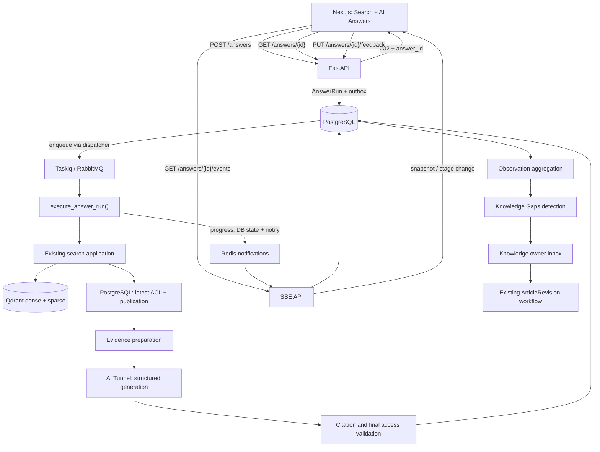
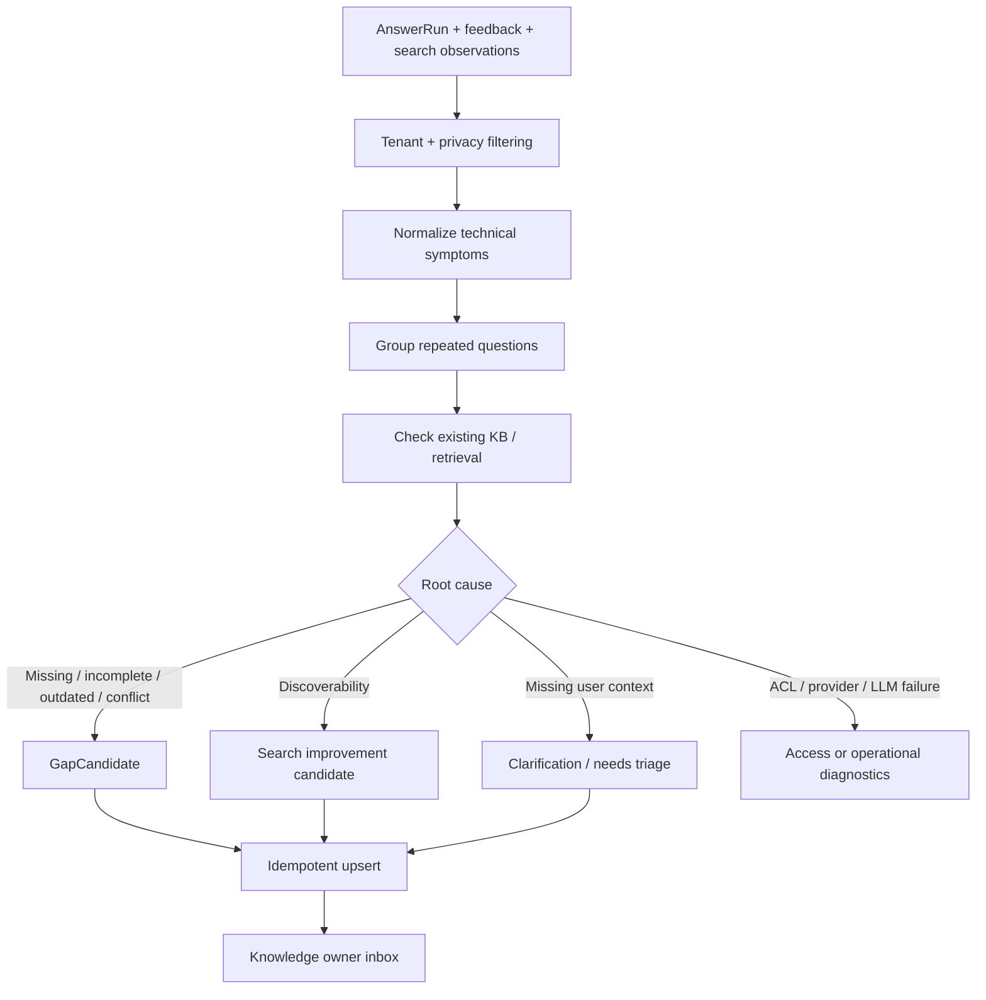
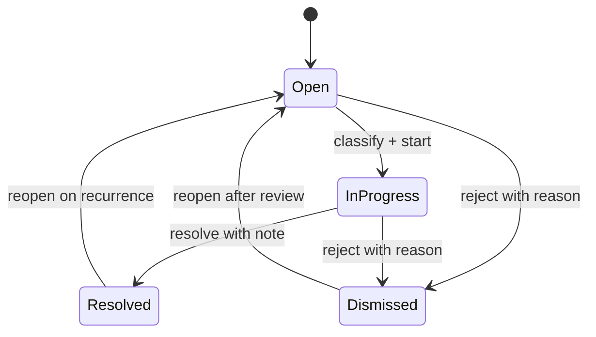

# DIOS KB — AI Answers & Knowledge Gaps: Implementation RFC

> **Статус:** архитектурное решение и план реализации (не утверждение, что всё ниже уже реализовано).  
> **Дата:** 21 ноября 2026 г.  
> **Назначение:** практическая спецификация backend, API, инфраструктуры, UI-событий, сохранения результатов, feedback и жизненного цикла Knowledge Gaps.  
> **Область:** DIOS KB: AI Answers, сохранение результатов, прогресс выполнения, feedback, Knowledge Gaps и редакторские workflows.

## Содержание

1. [Цели, границы и решения](#1-цели-границы-и-решения)
2. [Архитектура и ответственность слоёв](#2-архитектура-и-ответственность-слоёв)
3. [Стек и состав процессов](#3-стек-и-состав-процессов)
4. [Структура проекта](#4-структура-проекта)
5. [AI Answers: модели и контракты](#5-ai-answers-модели-и-контракты)
6. [AI Answers: retrieval, generation, citations](#6-ai-answers-retrieval-generation-citations)
7. [AnswerRun: сохранение, usage и восстановление](#7-answerrun-сохранение-usage-и-восстановление)
8. [Progress events и SSE](#8-progress-events-и-sse)
9. [API и UX-контракт](#9-api-и-ux-контракт)
10. [Feedback: модель и применение](#10-feedback-модель-и-применение)
11. [Knowledge Gaps: семантика и доменная модель](#11-knowledge-gaps-семантика-и-доменная-модель)
12. [Knowledge Gaps: обнаружение, группировка и хранение](#12-knowledge-gaps-обнаружение-группировка-и-хранение)
13. [Knowledge Gaps: редакторский workflow и доступ](#13-knowledge-gaps-редакторский-workflow-и-доступ)
14. [AI-assisted authoring: будущее расширение](#14-ai-assisted-authoring-будущее-расширение)
15. [Безопасность и эксплуатация](#15-безопасность-и-эксплуатация)
16. [Тесты, метрики и acceptance criteria](#16-тесты-метрики-и-acceptance-criteria)
17. [План реализации](#17-план-реализации)
18. [Решения, которые пока не принимаем](#18-решения-которые-пока-не-принимаем)

---

## 1. Цели, границы и решения

### 1.1. Продуктовая цель

AI Answers — **встроенный в поиск DIOS KB** механизм получения развёрнутого, проверяемого ответа из доступных пользователю опубликованных знаний. Он должен помогать перейти от вопроса к решению, показывать ссылки на **конкретные фрагменты источников** и корректно признавать недостаточность или противоречивость доказательств.

Knowledge Gaps — независимая подсистема, выявляющая **повторяющиеся проблемы с доступностью и качеством знаний**. Она превращает подтверждённые сигналы в управляемые задачи редакторам; не пишет и не публикует инструкции автоматически.

**UX:** обычная поисковая выдача доступна сразу; AI-ответ формируется по отдельному действию. В процессе пользователь видит реальные стадии работы, **не поток токенов**. Готовый ответ показывается целиком после валидации и сохранения.

### 1.2. Зафиксированные решения

| Тема | Решение | Причина |
|---|---|---|
| RAG | Non-agentic hybrid retrieve → evidence → один LLM-вызов → citation validation | Прозрачность, скорость, стоимость, тестируемость |
| Domain для ответа | **Не создавать** `Answer(AggregateRoot)` | Ответ — результат исполнения, не самостоятельная бизнес-сущность |
| Хранение ответов | **Да**: каждый запуск — `AnswerRun` с usage, моделью, источниками, latency, статусом | Мониторинг, аналитика, feedback, восстановление |
| Транспорт создания | REST `POST` → `202 Accepted + answer_id` | Отвязать выполнение от HTTP-соединения |
| Выполнение | Taskiq worker; короткие транзакции PostgreSQL | Переживать закрытие вкладки, прокси-таймауты, рестарты |
| Progress | SSE от API; Redis уведомляет об изменениях; PostgreSQL хранит snapshot | Односторонние события и реконнект без browser polling |
| Ответ в UI | Целиком после `COMPLETED`; **без token streaming** | Цитаты и структура уже проверены |
| WebSocket | Не обязателен для Answers; возможен позже поверх тех же событий | Для этой операции не нужен двусторонний канал |
| Feedback | Один актуальный отзыв на ответ от автора; `PUT`; thumbs up/down + причины | Простой UX и идемпотентность |
| Gap detection | Асинхронный, по накопленным observation-сигналам | Не нагружать основной запрос, не создавать ложные gaps |
| Domain для gap | **Да**, небольшой `KnowledgeGap` aggregate | Владелец, классификация, переходы статусов, закрытие |
| Редакторы gaps | Владелец знаний/редактор пространства; организационный triage при неопределённой области | Ответственность и ограничение доступа |
| MCP | Внутри Answers **не вызывать**; MCP — отдельный внешний API к тем же application search/read операциям | Не делать лишний сетевой hop |
| AI-соавтор | Позднее: guided interview → проверяемый черновик → human review | Недостающий контекст не должен выдумываться |
| Интернет-поиск | Позднее, опционально и только в контролируемом режиме официальных источников | Внешний источник не подтверждает внутренний инцидент |

### 1.3. Не цели текущего этапа

Не реализуем полноформатный чат, память диалога, собственный agent executor, неограниченный web browsing, автопубликацию новых статей, сложный multi-step agentic RAG, глобальный центр event sourcing и новую общую DI-библиотеку.

---

## 2. Архитектура и ответственность слоёв



**Ответственность:**

- `domain/knowledge_gaps`: переходы состояний редакторской проблемы; **не знает** про LLM, Taskiq, HTTP, SQLAlchemy.
- `application/answers`: оркестрация retrieval/generate/validate, DTO и контракты; **не знает** про Redis и SSE.
- `application/knowledge_gaps`: сигнал → группировка → проверка причины → кандидат → сохранение/triage; **не публикует** статьи.
- `application/search`: единственная точка выполнения hybrid search и авторитетной проверки актуальных READ grants, организации и опубликованной редакции.
- `infra`: PostgreSQL, Qdrant, AI Tunnel, Taskiq, Redis, обработка ошибок провайдера.
- `api`: HTTP endpoints, authentication dependency, права, сериализация, SSE delivery.
- `domain/articles`: **единственный** владелец статей, редакций, публикации и их инвариантов.

**Ключевое правило:** после поиска Qdrant результат обязан пройти PostgreSQL final ACL/publication check **до передачи текста LLM**, а при выдаче сохранённого ответа нужно учитывать актуальные права снова.

---

## 3. Стек и состав процессов

| Назначение | Технология |
|---|---|
| Runtime/API | Python 3.13, FastAPI, Pydantic v2 |
| Domain / application | dataclasses для сущностей, Pydantic для DTO, `Callable` для однооперационных зависимостей |
| OLTP и долговременные результаты | PostgreSQL, SQLAlchemy asyncio, Alembic |
| Retrieval | Существующий Qdrant hybrid search (dense/sparse) + SQL final filtering |
| LLM | Существующий AI Tunnel adapter / роутинг моделей |
| Очередь выполнения | Taskiq + RabbitMQ; повторные доставки учитываются |
| Progress notifications | Redis Pub/Sub **как транспорт уведомлений**, не источник истины |
| Realtime browser | SSE (`sse-starlette` / `EventSourceResponse`) |
| Ограничения и защита | DDF RateLimiter + Redis backend, concurrency quota |
| Observability | Логи с correlation/run ID, OpenTelemetry при наличии, сохранённые usage/latency |
| Frontend | Next.js, обычный Search UI, SSE client, карточка готового ответа |

Процессы разделены: API обслуживает HTTP/SSE, worker выполняет inference. Они используют общий код use cases/фабрик, но имеют **отдельные composition roots и свои connection pools**. `AsyncSession` не разделяется между параллельными задачами.

Redis — опциональный инфраструктурный компонент в локальной одноинстансовой разработке (можно реализовать in-process notifier); **для распределённой production-доставки** нужен межинстансовый канал. При этом нельзя считать Redis Pub/Sub долговременным журналом событий.

---

## 4. Структура проекта

```text
src/
├── domain/
│   ├── articles/                     # Существующий BC
│   └── knowledge_gaps/
│       ├── models.py                # KnowledgeGap aggregate
│       └── types.py                 # GapKind / GapStatus
│
├── application/
│   ├── auth/                         # Существующий Auth, AuthUser, AuthType
│   ├── search/                       # Существующий hybrid search + final ACL
│   ├── answers/
│   │   ├── config.py                # AnswersConfig
│   │   ├── dtos.py                  # AnswerRequest/Response/Draft/Source/Block
│   │   ├── models.py                # AnswerRun/Usage/Stage/Status (application)
│   │   ├── evidence.py              # Подготовка, дедупликация, контекст
│   │   ├── citations.py             # Чистая валидация source IDs
│   │   ├── types.py                 # GenerateAnswer / SearchForAnswer / ReportProgress
│   │   ├── repositories.py          # AnswerRunStore / FeedbackStore (ports)
│   │   ├── feedback.py              # Сохранение/обновление feedback
│   │   └── usecases.py              # execute_answer_run(), получение результата
│   └── knowledge_gaps/
│       ├── signals.py               # GapSignal DTO/kinds
│       ├── dtos.py                  # GapCandidate / queries / public DTO
│       ├── detection.py             # Группировка, оценка, маршрутизация
│       ├── repositories.py          # GapStore, SignalStore (ports)
│       └── usecases.py              # triage, assign, resolve, dismiss
│
├── infra/
│   ├── aitunnel/                     # Existing LLM / embedding adapter
│   ├── database/
│   │   ├── models/
│   │   │   ├── answers.py           # answer_runs, answer_feedback
│   │   │   └── knowledge_gaps.py    # gap_signals, knowledge_gaps, associations
│   │   └── repositories/
│   │       ├── answer_runs.py
│   │       ├── answer_feedback.py
│   │       ├── gap_signals.py
│   │       └── knowledge_gaps.py
│   ├── realtime/
│   │   └── answer_progress.py       # DB snapshot + Redis notifier / subscriber
│   └── broker/
│       ├── tasks.py                 # Taskiq answer + detection tasks
│       └── worker.py                # Resource lifecycle + composition
│
└── api/
    └── routers/
        ├── answers.py               # POST, GET, feedback, GET events
        └── knowledge_gaps.py        # Editorial endpoints
```

**Это целевая группировка, не требование создать все файлы до первого рабочего endpoint.** Если один модуль содержит две небольшие функции, не нужно искусственно дробить его. Существующий `src/infra` и DIOS naming conventions сохраняются. Для инфраструктуры зависимостей предпочтительны `partial()`, обычные фабрики и `AsyncExitStack`, а не масштабный DI-контейнер.

---

## 5. AI Answers: модели и контракты

### 5.1. Транспортные DTO — `application/answers/dtos.py`

```python
from enum import StrEnum
from uuid import UUID

from pydantic import BaseModel, ConfigDict, Field
from pydantic.alias_generators import to_camel


class AnswerStatus(StrEnum):
    ANSWERED = "answered"
    INSUFFICIENT_EVIDENCE = "insufficient_evidence"
    CONFLICTING_EVIDENCE = "conflicting_evidence"


class AnswerDTO(BaseModel):
    model_config = ConfigDict(
        alias_generator=to_camel,
        validate_by_name=True,
        serialize_by_alias=True,
    )


class AnswerRequest(AnswerDTO):
    question: str = Field(min_length=2, max_length=2000)
    space_ids: list[UUID] | None = Field(default=None, max_length=100)


class AnswerSource(AnswerDTO):
    id: str                      # Назначается сервером, например src_1
    article_id: UUID
    revision_id: UUID
    chunk_id: UUID
    title: str
    url: str                    # Строится сервером, не LLM
    excerpt: str
    anchor: str | None = None


class AnswerBlock(AnswerDTO):
    markdown: str
    citations: list[str] = Field(default_factory=list)


class AnswerDraft(BaseModel):
    """Недоверенный результат LLM до validation."""
    status: AnswerStatus
    blocks: list[AnswerBlock]
    missing_context: list[str] = Field(default_factory=list)


class AnswerResponse(AnswerDTO):
    id: UUID
    status: AnswerStatus
    blocks: list[AnswerBlock]
    sources: list[AnswerSource]
    missing_context: list[str] = Field(default_factory=list)
```

**Почему `AnswerBlock`:** отдельные фрагменты ответа с локальными citation IDs проще валидировать и отображать, чем свободный Markdown с произвольными URL от LLM. Ссылка рядом с блоком — **не доказательство**, что утверждение подтверждено: валидный source ID гарантирует лишь ссылочную целостность.

`space_ids=None` значит «все пространства, доступные principal»; `space_ids=[]` означает **пустую область**, а не отсутствие фильтра.

### 5.2. Модель выполнения — `application/answers/models.py`

```python
from datetime import datetime
from decimal import Decimal
from enum import StrEnum
from uuid import UUID

from pydantic import BaseModel, ConfigDict, Field

from .dtos import AnswerResponse, AnswerStatus


class AnswerRunStatus(StrEnum):
    QUEUED = "queued"
    RUNNING = "running"
    COMPLETED = "completed"
    FAILED = "failed"
    CANCELLED = "cancelled"


class AnswerStage(StrEnum):
    RETRIEVAL = "retrieval"
    CONTEXT_PREPARATION = "context_preparation"
    GENERATION = "generation"
    VALIDATION = "validation"


class AnswerUsage(BaseModel):
    model_config = ConfigDict(frozen=True)

    input_tokens: int = Field(ge=0)
    output_tokens: int = Field(ge=0)
    cached_input_tokens: int = Field(default=0, ge=0)
    reasoning_tokens: int | None = Field(default=None, ge=0)
    estimated_cost_usd: Decimal | None = None


class AnswerRun(BaseModel):
    """Долговременная запись попытки, НЕ доменный агрегат."""

    id: UUID
    organization_id: UUID
    principal_id: UUID
    principal_type: str
    status: AnswerRunStatus
    stage: AnswerStage | None = None
    stage_sequence: int = 0

    question: str | None = None
    answer_status: AnswerStatus | None = None
    response: AnswerResponse | None = None

    provider: str | None = None
    model_id: str | None = None
    prompt_version: str | None = None
    retrieval_version: str | None = None
    usage: AnswerUsage | None = None

    latency_ms: int | None = None
    error_code: str | None = None
    created_at: datetime
    started_at: datetime | None = None
    completed_at: datetime | None = None
```

- `AnswerRun.status` — **технический исход исполнения**; `AnswerStatus` — **состояние доказательной базы/ответа**.
- `COMPLETED + INSUFFICIENT_EVIDENCE` — валидный результат; `FAILED` — technical failure, **не gap**.
- Использованная модель — фактическая (`provider/model_id` после routing), не только запрошенная.
- `cached_input_tokens` — подмножество `input_tokens`, **не прибавляется повторно** к стоимости.
- `reasoning_tokens` / breakdown зависят от provider; отсутствующее значение не следует подменять нулём без проверки.
- `estimated_cost_usd` — **расчёт**, если провайдер не даёт фактического billing. Для достоверного анализа хранить price policy/version и currency.
- `question/response` nullable под `metadata_only` privacy mode; разрешённые исходные тексты можно хранить в `full` с retention.

### 5.3. Адаптер generation возвращает usage вместе с ответом

Ранее обсуждавшийся `GenerateAnswer -> AnswerDraft` расширяем для наблюдаемости: иначе стоимость успешной или частично неудачной генерации потеряется.

```python
from collections.abc import Awaitable, Callable, Sequence
from dataclasses import dataclass

from .dtos import AnswerDraft, AnswerSource
from .models import AnswerUsage


@dataclass(frozen=True, slots=True)
class GeneratedAnswer:
    draft: AnswerDraft
    usage: AnswerUsage | None
    provider: str
    model_id: str
    generation_ms: int


type GenerateAnswer = Callable[
    [str, Sequence[AnswerSource]],
    Awaitable[GeneratedAnswer],
]
```

Если provider вернул токены, но structured output оказался недействительным, infrastructure должна попытаться сохранить доступные usage/metrics и ошибку **без** публикации некорректного ответа. При нескольких inference calls следует хранить usage по вызовам и агрегировать отдельно; для MVP предполагается один вызов.

### 5.4. Конфигурация — `AnswersConfig`

```python
from pydantic import Field, PositiveInt
from pydantic_settings import BaseSettings, SettingsConfigDict


class AnswersConfig(BaseSettings):
    model_config = SettingsConfigDict(env_prefix="ANSWERS_", frozen=True)

    candidates_limit: PositiveInt = Field(default=8, le=50)
    max_sources: PositiveInt = Field(default=12, le=50)
    max_excerpt_chars: PositiveInt = Field(default=4000)
    max_output_tokens: PositiveInt = Field(default=1500)
    retrieval_timeout: float = Field(default=10.0, gt=0)
    generation_timeout: float = Field(default=60.0, gt=0)
    total_timeout: float = Field(default=90.0, gt=0)
    progress_heartbeat_seconds: float = Field(default=12.0, gt=0)
```

Числа — **стартовые гипотезы для пилота**, не SLA. Общий deadline и лимиты должны быть согласованы с фактическим временем поиска и моделями. `max_excerpt_chars` защищает только размер отдельного фрагмента; для context packing необходим **общий token budget**.

---
## 6. AI Answers: retrieval, generation, citations

### 6.1. Non-agentic pipeline

```text
Validated AnswerRequest + trusted Auth
    ↓
Existing hybrid search (Qdrant + SQL verification)
    ↓
Authorized SearchResponse
    ↓
Dedup + context packing + source IDs
    ↓
GenerateAnswer (один LLM-вызов, structured output)
    ↓
Citation validation + access recheck
    ↓
AnswerResponse
```

**Нет** вызова собственного MCP из Answers, бесконечного loop, произвольных tools или поиска в интернете при обычном ответе. Последовательность детерминирована и тестируема.

Сохраняем **обычные результаты поиска отдельно**: они отображаются параллельно с ожиданием AI Answers, а отсутствие AI не препятствует поиску.

### 6.2. Retrieval и доказательства

Используем существующий `SearchResponse` **после** авторитетной SQL-проверки. В нём должны быть идентификаторы текущих опубликованных редакций и разрешённые фрагменты. Для данной спецификации имена полей результата поиска условны — при реализации адаптировать к фактическим `SearchArticle`/`SearchFragment`, не добавлять дублирующий поисковый движок.

`build_sources()` — **чистая функция**, без SQL, LLM или IAM:

```python
from collections.abc import Callable

from .dtos import AnswerSource

# SearchResponse, SearchArticle, SearchFragment — существующие application DTO.
type BuildSourceUrl = Callable[[object, object], str]


def build_sources(
    search_results, *, build_url: BuildSourceUrl, limit: int, max_chars: int
) -> list[AnswerSource]:
    """Адаптер фактических полей SearchResponse → AnswerSource.

    Предусловие: search_results уже прошёл актуальную ACL/publication check.
    """
    result: list[AnswerSource] = []
    seen: set[tuple[object, object, object]] = set()

    for match in search_results.items:
        article = match.article
        for fragment in match.fragments:
            key = (article.id, article.revision_id, fragment.chunk_id)
            if key in seen or not fragment.text.strip():
                continue
            seen.add(key)
            result.append(
                AnswerSource(
                    id=f"src_{len(result) + 1}",
                    article_id=article.id,
                    revision_id=article.revision_id,
                    chunk_id=fragment.chunk_id,
                    title=article.title,
                    url=build_url(article, fragment),
                    excerpt=fragment.text[:max_chars],
                    anchor=getattr(fragment, "anchor", None),
                )
            )
            if len(result) >= limit:
                return result
    return result
```

> Пример показывает форму адаптера, не гарантирует совпадения полей с текущим Search API. В production заменить `object`/неаннотированные аргументы точными DTO, если они уже определены в проекте. `fragment.text[:max_chars]` — только MVP; для Markdown и кода нужно обрезать по смысловым блокам.

**Что необходимо учесть:**

- Не включать в LLM сырой hit из Qdrant без ACL и проверки текущей опубликованной редакции.
- Уважать `space_ids`: пустой список не становится `None`.
- Для длинных инструкций добавлять соседние структурные chunks только в пределах **той же проверенной редакции**; иначе можно потерять шаги/предпосылки.
- OCR, использованный для `search_text`, может отсутствовать в Markdown `fragment.text`. Нужен отдельный авторизованный путь доставки OCR evidence, если качество ответов требует содержимого скриншотов.
- Возвращать проверенные `article_id`, `revision_id`, `chunk_id`, anchor / heading path. После публикации новой редакции старые deep links не должны позволять читать закрытый материал.
- Ранжирование Qdrant отражает релевантность, **не надёжность** источника.
- На этапе packing исключать дубли, соблюдать общее ограничение токенов, не смешивать несовместимые условия применения.

### 6.3. Citation validation

```python
from .dtos import AnswerDraft, AnswerStatus


class InvalidGeneratedAnswerError(RuntimeError):
    pass


def validate_draft(draft: AnswerDraft, allowed_source_ids: set[str]) -> set[str]:
    referenced = {
        source_id
        for block in draft.blocks
        for source_id in block.citations
    }
    if not referenced.issubset(allowed_source_ids):
        raise InvalidGeneratedAnswerError("LLM referenced unknown source IDs")
    if draft.status is AnswerStatus.ANSWERED:
        if not draft.blocks or not referenced:
            raise InvalidGeneratedAnswerError("Grounded answer requires citations")
        if not any(block.markdown.strip() for block in draft.blocks):
            raise InvalidGeneratedAnswerError("Empty answer")
    return referenced
```

**Проверяется:** структурная валидность, допустимость ID, наличие оснований для `ANSWERED`, ограничения размера/Markdown. **Не проверяется этим кодом:** соответствует ли конкретное утверждение содержимому цитируемого абзаца. Нужны evals и при необходимости claim-level verification.

Сервер строит URL из разрешённых `article/revision/anchor`, **не принимает** ссылку, придуманный LLM. Frontend рендерит Markdown безопасно, не доверяет произвольным HTML и javascript-ссылкам модели.

### 6.4. Оркестрация и граница persistence

В `application/answers` лучше разделить две функции:

- `answer_question(...) -> AnswerResponse + GeneratedAnswer metadata`: **чистая прикладная orchestration** над search/generate, без HTTP и SQL;
- `execute_answer_run(run_id, ...)`: **application runner**, загружает input/actor из store, захватывает запуск, сообщает этапы, вызывает `answer_question` и фиксирует исход.

Контракты (показаны схематично; точные `SearchRequest/SearchResponse` должны быть взяты из текущего проекта):

```python
from collections.abc import Awaitable, Callable, Sequence
from uuid import UUID

from src.application.auth.dtos import Auth
from src.application.search.dtos import SearchRequest, SearchResponse

from .dtos import AnswerSource
from .models import AnswerStage


type SearchForAnswer = Callable[
    [UUID, Auth, SearchRequest], Awaitable[SearchResponse]
]

type ReportProgress = Callable[
    [UUID, AnswerStage, dict[str, int]], Awaitable[None]
]

type ResolveExecutionAuth = Callable[
    [UUID, UUID, str], Awaitable[Auth]
]
```

**Необходимое условие для фонового исполнения:** actor/organization из сохранённого `AnswerRun` — только идентификаторы. Worker **не должен** доверять историческим ролям и не должен хранить сырой пользовательский access token в Taskiq payload. `ResolveExecutionAuth` получает **актуальную авторизацию** через доверенную backend/IAM-интеграцию, после чего search/read применяют grants. Без возможности такой серверной делегации нужно отдельно определить короткоживущую on-behalf-of credential и её revocation; нельзя подставлять всесильный admin.

Условная структура прикладного кода (без подключения конкретных репозиториев):

```python
async def answer_question(
    organization_id, auth, request, *, search, generate, build_url, config, on_stage
):
    await on_stage(AnswerStage.RETRIEVAL, {})
    results = await search(
        organization_id,
        auth,
        SearchRequest(
            query=request.question,
            space_ids=request.space_ids,
            limit=config.candidates_limit,
        ),
    )
    # Важно: results уже проверен SQL ACL/publication.
    await on_stage(AnswerStage.CONTEXT_PREPARATION, {"results_count": len(results.items)})
    sources = build_sources(
        results,
        build_url=build_url,
        limit=config.max_sources,
        max_chars=config.max_excerpt_chars,
    )
    if not sources:
        return make_insufficient_evidence_response(), None

    await on_stage(AnswerStage.GENERATION, {"sources_count": len(sources)})
    generated = await generate(request.question, sources)
    await on_stage(AnswerStage.VALIDATION, {})
    used_ids = validate_draft(generated.draft, {source.id for source in sources})
    response = make_response(generated.draft, sources, used_ids)
    return response, generated
```

`make_insufficient_evidence_response` и `make_response` — простые функции сборки DTO, их точную форму реализовать по текущим сигнатурам проекта. Код иллюстрирует **последовательность действий**, а не готовый drop-in модуль.

**Перед выдачей / сохранением завершённого результата** нужно предусмотреть проверку, что исходные READ grants и опубликованные редакции всё ещё подходят. При отзыве доступа во время LLM-вызова ответ не должен раскрываться. Для сохранённых ответов проверять доступ на `GET`/возврате источников заново. Если обеспечить такие проверки невозможно — защищённый отказ с `ACCESS_CHANGED` и без текста ответа.

### 6.5. Ошибки и abstention

- `INSUFFICIENT_EVIDENCE`: retrieval успешно выполнен, но допустимых доказательств не хватает.
- `CONFLICTING_EVIDENCE`: обнаружены конфликтующие сведения, требуется указать условия/неопределённость.
- `FAILED`: ошибка provider, timeout, invalid structured output, нарушение security invariant; **не** создавать content gap только по этой причине.
- `ACCESS_CHANGED`: возвращать как безопасную ошибку без приватного содержимого, при необходимости маркировать run как `FAILED` с соответствующим `error_code`.

**Запрещено:** считать каждый `SearchResponse.items == []` доказательством отсутствия статьи в организации. Могло не хватить прав, retrieval мог не найти документ или запрос был слишком узким.

---

## 7. AnswerRun: сохранение, usage и восстановление

### 7.1. Почему persisted run, но не domain aggregate

`AnswerRun` — запись **попытки** с identity/status/metrics. Её стадии технические (`QUEUED → RUNNING → COMPLETED/FAILED/CANCELLED`), а не отдельный бизнес-workflow, требующий агрегата DDD. Можно хранить как Pydantic application model + SQLAlchemy ORM.

Выполнение **не зависит от SSE-соединения**. Закрытие вкладки ≠ отмена генерации. Явная отмена при необходимости добавляется отдельным авторизованным endpoint и механизмом cooperative cancellation.

### 7.2. SQL-модель (концептуальные поля)

`answer_runs`:

| Колонка | Тип / смысл |
|---|---|
| `id` | UUID PK |
| `organization_id` | UUID, обязательная tenant-граница |
| `principal_id`, `principal_type` | Инициатор |
| `status`, `stage`, `stage_sequence` | Технический lifecycle + монотонная версия snapshot |
| `question` | TEXT nullable, согласно privacy mode |
| `response` | JSONB nullable: blocks + source refs, только после проверки |
| `answer_status` | enum nullable |
| `provider`, `model_id` | Фактическая модель |
| `prompt_version`, `retrieval_version` | Аналитика регрессий |
| `usage` | JSONB nullable; проверенная структура токенов |
| `estimated_cost_usd`, `price_version` | NUMERIC + версия тарифов (опционально) |
| `metrics` | JSONB: timings, counts, retries; не секреты |
| `error_code` | Безопасный код, без stack trace |
| `started_at`, `created_at`, `completed_at` | TIMESTAMPTZ |
| `lease_owner`, `lease_expires_at` | Для дедупликации выполнения и recovery, если выбран lease-механизм |
| `idempotency_key` | nullable, scoped на principal+organization для client retries |

Рекомендуемые индексы: `(organization_id, principal_id, created_at DESC)`, `(organization_id, status, created_at DESC)`, индекс для expired leases/старых `RUNNING`; уникальность client idempotency с учётом organization/principal. Не индексировать бесконтрольно JSONB с полным текстом.

Пример ORM-фрагмента:

```python
from datetime import datetime
from uuid import UUID

from ddf.infra.database.sqlalchemy import Base
from sqlalchemy import DateTime, ForeignKey, Integer, String, func
from sqlalchemy.dialects.postgresql import JSONB
from sqlalchemy.orm import Mapped, mapped_column


class AnswerRunOrm(Base):
    __tablename__ = "answer_runs"

    id: Mapped[UUID] = mapped_column(primary_key=True)
    organization_id: Mapped[UUID] = mapped_column(index=True)
    principal_id: Mapped[UUID]
    principal_type: Mapped[str] = mapped_column(String(32))
    status: Mapped[str] = mapped_column(String(32), index=True)
    stage: Mapped[str | None] = mapped_column(String(32))
    stage_sequence: Mapped[int] = mapped_column(Integer, default=0)
    response: Mapped[dict | None] = mapped_column(JSONB)
    usage: Mapped[dict | None] = mapped_column(JSONB)
    error_code: Mapped[str | None] = mapped_column(String(64))
    created_at: Mapped[datetime] = mapped_column(
        DateTime(timezone=True), server_default=func.now()
    )
    completed_at: Mapped[datetime | None] = mapped_column(DateTime(timezone=True))
```

> Фрагмент не полная миграция — дополнить поля из таблицы выше, индексы, ограничения, tenant-индексацию и retention. Политика удаления содержимого должна быть предусмотрена отдельно от удаления usage-метаданных.

### 7.3. Порт хранилища

Для `AnswerRunStore` класс/`Protocol` оправдан: он объединяет несколько атомарных операций и транзакционные инварианты.

```python
from typing import Protocol
from uuid import UUID

from .dtos import AnswerResponse
from .models import AnswerRun, AnswerUsage, AnswerStage


class AnswerRunStore(Protocol):
    async def create(self, run: AnswerRun) -> None: ...

    async def claim(self, run_id: UUID, *, owner: str, lease_seconds: int) -> AnswerRun | None: ...

    async def update_stage(
        self, run_id: UUID, stage: AnswerStage, *, metrics: dict[str, int]
    ) -> int: ...  # Возвращает новое stage_sequence.

    async def complete(
        self,
        run_id: UUID,
        *,
        response: AnswerResponse,
        usage: AnswerUsage | None,
        metadata: dict[str, object],
    ) -> None: ...

    async def fail(self, run_id: UUID, *, code: str) -> None: ...

    async def get(self, run_id: UUID, *, organization_id: UUID) -> AnswerRun | None: ...
```

В `claim` следует выполнять атомарный условный UPDATE/lease с проверкой статуса/lease expiry. При повторной доставке Taskiq второй worker должен **не выполнять** дорогой LLM-call. Простой `SELECT` без захвата недостаточен. Начальный lease нужно продлевать, а ownership проверять и на `complete/fail` (fencing или сопоставление lease token), чтобы запоздавший worker не перезаписал более новый результат.

`update_stage` сохраняет снимок состояния и увеличивает sequence **в одной транзакции**; уведомление Redis следует отправлять **после** commit. `complete()` сохраняет ответ, usage и `COMPLETED` атомарно. `fail()` нормализует ошибку и не записывает секреты или полный traceback в возвращаемый JSON.

### 7.4. Создание run и надёжная постановка Taskiq

1. Аутентификация и проверка права запускать Answers.
2. Проверка лимитов/квот, размера вопроса и контекста.
3. Создание `QUEUED` run (+ idempotency mapping).
4. **В той же транзакции** запись события в DDF Outbox «generate_answer(run_id)».
5. Dispatcher отправляет Taskiq message через RabbitMQ; worker получает только `run_id`.
6. Worker `claim()` → `RUNNING` → retrieval/generation/validation → `complete/fail`.
7. Ответ на `POST`: `202 Accepted` с `id`, `status`, ссылками на events/result.

Почему Outbox: если выполнить `DB commit` и затем `broker.enqueue`, падение между ними оставит run без задачи. Outbox обеспечивает повторяемую передачу; доставка **как минимум один раз**, поэтому claim/idempotency всё равно обязательны.

### 7.5. Случаи отказа и recovery

- Worker crash → lease истёк → requeue/recovery job; не держать PostgreSQL-транзакцию вокруг LLM.
- Browser disconnect → run продолжается, SSE-подписчик исчезает.
- AI Tunnel timeout → `FAILED`, `error_code=LLM_TIMEOUT`, без ложного gap.
- LLM structured output invalid → `FAILED` или контролируемый retry с лимитом; usage по возможности учитывается.
- Повторный `POST` с тем же idempotency key → вернуть прежний run, а не повторно списывать токены.
- Перезапуск API/Redis → новый подписчик читает состояние из PostgreSQL.
- Полное отсутствие наблюдателей не влияет на выполнение.
- Reconciliation отвечает за stale `QUEUED/RUNNING`, а не за поиск контентных gaps.

### 7.6. Privacy modes и жизненный цикл сохранённых данных

Рекомендуемые политики организации:

- `metadata_only`: сохраняются identity/status/usage/metrics/source references, но не полный вопрос или текст ответа; этот режим несовместим с долговременным просмотром результата — нужно явно выбрать UX-поведение/короткий TTL результата.
- `full`: сохраняются вопрос и ответ, с retention, scoped ACL, возможной encryption at rest, аудитом доступа, удалением по политике организации.

Результат может содержать выдержки из закрытых статей. При `GET /answers/{id}` нельзя ограничиваться проверкой владельца run: необходимо учитывать актуальную возможность получить сохранённый текст и источники. Варианты — повторно проверить каждую source revision/access или аннулировать/редактировать ответ, если права изменились. Не выдавать старую скрытую цитату из сохранённого JSONB.

Usage и технические метрики могут храниться дольше контента при надлежащей политике хранения и минимизации.

---
## 8. Progress events и SSE

### 8.1. Почему SSE, а не WebSocket

AI Answers — **одноразовая команда** (`POST`) и однонаправленный поток обновлений от сервера. SSE проще для подключения к Next.js, proxy и восстановления соединения. WebSocket DDF остаётся вариантом для будущего общего realtime-канала DIOS, но отдельный WS-канал Answers сейчас не улучшит семантику выполнения.

**Пользователь видит реальные этапы, не токены:**

```text
✓ Запрос принят
✓ Поиск завершён — найдено 10 доступных результатов
✓ Подготовлено 4 источника
◌ Формируем ответ на основе источников…
✓ Проверка ссылок и сохранение
✓ Готовый ответ
```

Числа — только **после авторитетной SQL-проверки доступа**. Не показывать число скрытых hits из Qdrant, проценты готовности inference, выдуманные таймеры или «AI думает», если нет соответствующего реального состояния.

### 8.2. Run status, stage и event — разные понятия

- `AnswerRunStatus`: `QUEUED/RUNNING/COMPLETED/FAILED/CANCELLED` — долгоживущий исход.
- `AnswerStage`: `RETRIEVAL/CONTEXT_PREPARATION/GENERATION/VALIDATION` — текущий шаг.
- `AnswerProgressEvent`: уведомление клиенту об изменении snapshot; не обязательно сохранять каждое событие как отдельный доменный объект.

Пример событий (имена transport-level, API version можно закрепить в envelope):

| Событие | Условие | Данные для UI |
|---|---|---|
| `answer.queued` | Run и outbox зафиксированы | id |
| `retrieval.started` | Worker начал поиск | — |
| `retrieval.completed` | Поиск + ACL завершены | `results_count` |
| `context.prepared` | Selected evidence готов | `sources_count` |
| `generation.started` | Начат LLM inference | — |
| `validation.started` | Сформирован draft | — |
| `answer.completed` | Ответ + usage сохранены | `answer_id` |
| `answer.failed` | Техническая ошибка | безопасный `error_code` |
| `answer.cancelled` | При явной отмене (позднее) | — |
| `answer.snapshot` | Подключение/reconnect | текущее состояние и `stage_sequence` |

`retrieval.completed` не должен означать «ответ найден»: это только результаты поиска. `context.prepared` означает источники переданы для генерации. `answer.completed` наступает **после** commit валидного результата.

```python
from datetime import datetime
from enum import StrEnum
from uuid import UUID
from pydantic import BaseModel, Field


class AnswerProgressEvent(BaseModel):
    answer_id: UUID
    sequence: int = Field(ge=0)
    event: str
    occurred_at: datetime
    status: str
    stage: str | None = None
    results_count: int | None = None
    sources_count: int | None = None
    error_code: str | None = None
```

Строки UI/локализация формируются **на frontend по `event`/`stage`**, а не хранятся в ответах backend.

### 8.3. Источник истины и доставка

**PostgreSQL**: текущий `AnswerRun` snapshot (`status`, `stage`, `stage_sequence`, counters, error_code).  
**Redis Pub/Sub**: лёгкое уведомление «run изменился, перечитай snapshot» (`answer:{run_id}`).

Обновление в worker:

1. Транзакционно изменить `AnswerRun.stage`, `stage_sequence`, безопасные счётчики.
2. Commit.
3. Опубликовать Redis notification **после** commit.
4. Не отменять успешно сохранённое изменение из-за временного сбоя Redis.

**Надёжность:** Pub/Sub не сохраняет историю. После разрыва невозможно гарантировать replay **каждого** события только из Redis. Для UX достаточно получать **актуальное состояние**. Клиенту не обещается полный исторический журнал.

### 8.4. SSE endpoint — восстановление без browser polling

`GET /api/service/v1/answers/{id}/events`:

1. Аутентифицировать principal; авторизовать наблюдение `AnswerRun`.
2. Установить подписку на notification **до первого чтения snapshot**, иначе возможно пропустить событие между чтением БД и началом подписки.
3. Прочитать `AnswerRun` из PostgreSQL и отправить `answer.snapshot`.
4. При notification перечитать snapshot; отсылать только если `stage_sequence` вырос.
5. Отправлять SSE heartbeat комментарии (`: keepalive`), не создавая прогресс по таймеру.
6. Если Redis notification потеряно, периодически перепроверять snapshot на сервере, например на heartbeat, **не browser polling**; для строгого replay перейти на persisted `answer_events`/Redis Streams/Outbox.
7. При terminal status отправить завершающее событие, закрыть stream.
8. При reconnect заново проверить права и отправить snapshot, даже если run уже завершён.

**`Last-Event-ID`:** можно включать `stage_sequence` как SSE id, но это само по себе **не гарантирует replay**. С текущей архитектурой reconnect отдаёт последний snapshot. Если бизнесу понадобится вся последовательность, сделать durable event log с запросом по offset.

Пример SSE фреймов:

```text
event: answer.snapshot
id: 2
data: {"status":"running","stage":"retrieval","sequence":2}

event: retrieval.completed
id: 3
data: {"status":"running","stage":"context_preparation","sequence":3,"resultsCount":10}

: keepalive

event: generation.started
id: 5
data: {"status":"running","stage":"generation","sequence":5,"sourcesCount":4}

event: answer.completed
id: 7
data: {"status":"completed","sequence":7,"answerId":"550e8400-e29b-41d4-a716-446655440000"}
```

После `answer.completed` frontend вызывает обычный авторизованный `GET /answers/{id}` и отображает **полный** `AnswerResponse`. В последующем можно присылать проверенный результат в SSE, но это увеличивает объём и усложняет повторную авторизацию.

### 8.5. Прокси, heartbeat и реальные таймауты

Различать:

- **Idle timeout:** нет байтов в течение интервала — heartbeat SSE помогает.
- **Absolute request/connection timeout:** лимит общей длительности независимо от активности — heartbeat **не помогает**. Клиент переподключается, worker продолжает отдельно.
- **Backend generation timeout:** ограничивает реальный LLM/inference — heartbeat не продлевает выполнение.

Для Nginx/Ingress проверить:

- `Content-Type: text/event-stream`;
- `Cache-Control: no-store, no-transform`;
- `X-Accel-Buffering: no` и/или `proxy_buffering off` на этом маршруте;
- отсутствие прокси-сжатия, буферизующего мелкие события;
- `proxy_read_timeout` больше интервала heartbeat;
- `send_timeout` для медленных клиентов;
- общий route/ingress timeout и ограничения idle соединений;
- корректные CORS/credentials и проверку аутентификации.

Пример настройки (зависит от инфраструктуры, не копировать без проверки):

```nginx
location /api/service/v1/answers/ {
    proxy_pass http://kb_api;
    proxy_http_version 1.1;
    proxy_buffering off;
    proxy_read_timeout 120s;
    # Точное соответствие location для SSE/REST продумать в маршрутизации.
}
```

Heartbeat ~10–15 секунд — стартовая гипотеза, не универсальная гарантия. `EventSourceResponse` от `sse-starlette` подходит для протокола; не писать свой низкоуровневый SSE parser.

### 8.6. Next.js и Bearer authentication

Нативный `EventSource` **не умеет добавлять произвольный `Authorization: Bearer`**. Рекомендации:

- BFF: браузер обращается к same-origin Next.js endpoint с HttpOnly cookie, Next.js делегирует авторизацию DIOS KB; **или**
- Fetch-based SSE клиент с Authorization header, собственным reconnect/snapshot logic.

**Нельзя** прокидывать access token в `?token=` query string. Логи, history и analytics могут раскрыть его. SSE по `answer_id` требует повторной проверки ownership и tenant в API.

### 8.7. Cancellation

В MVP закрытие SSE **не** отменяет run. Если добавить кнопку «Отменить», нужен отдельный `POST /answers/{id}/cancel` с проверкой principal, маркером отмены и cooperative cancellation в Taskiq; гарантированное мгновенное прерывание уже выполняющегося provider call не всегда возможно. Учесть оплату частично завершённых вызовов.

---

## 9. API и UX-контракт

### 9.1. Основные endpoint

| Метод | Путь | Семантика |
|---|---|---|
| `POST` | `/api/service/v1/answers` | Валидация → create+outbox → `202`, без ожидания inference |
| `GET` | `/api/service/v1/answers/{id}` | Авторизованный snapshot/полный результат по статусу и privacy policy |
| `GET` | `/api/service/v1/answers/{id}/events` | SSE snapshot + progress + terminal |
| `PUT` | `/api/service/v1/answers/{id}/feedback` | Создать/заменить собственный feedback |

Ответ `POST`:

```json
{
  "id": "550e8400-e29b-41d4-a716-446655440000",
  "status": "queued",
  "eventsUrl": "/api/service/v1/answers/550e8400-e29b-41d4-a716-446655440000/events",
  "resultUrl": "/api/service/v1/answers/550e8400-e29b-41d4-a716-446655440000"
}
```

`Location` и `Retry-After` при необходимости. `GET` на незавершённую операцию может возвращать run snapshot без `response`; на успешную — snapshot + авторизованный результат. При `FAILED` выдавать безопасный error code; не возвращать stack trace. Для `metadata_only` предусмотреть короткоживущую отдачу результата или явное отсутствие истории содержимого.

### 9.2. UX поиска

1. Пользователь вводит запрос → PostgreSQL autocomplete предлагает заголовки.
2. Обычные результаты поиска появляются независимо от LLM.
3. Пользователь выбирает «Получить AI-ответ» → `POST`.
4. UI подписывается на SSE → показывает фактические этапы: принят, поиск, результаты, источники, генерация, проверка.
5. При `COMPLETED` получает готовый `AnswerResponse` и отображает его целиком с источниками.
6. Если `INSUFFICIENT_EVIDENCE`, показывает честное состояние и обычные материалы.
7. Пользователь может скопировать ответ, открыть конкретный доказательный фрагмент или оставить feedback.

**Не использовать:** автогенерацию на каждый символ, 100%-прогресс LLM, длинные «thinking traces», вывод непроверенных токенов, пустой UI вместо результатов поиска.

### 9.3. UI деталей источников

На `[src_1]` открывается drawer/popover с **актуально доступным** excerpt, заголовком и ссылкой к нужному heading/anchor. URL создаёт backend. При отзыве доступа не показывать кешированную выдержку.

Для troubleshooting ответы адаптивно структурируются как: короткий вывод → условия применения → шаги → проверка результата → ограничения/что уточнить. Для определения термина достаточно 1–2 абзацев. Шаблон выбирается по вопросу, не навязывается каждому ответу.

### 9.4. UX ошибок и недостатка данных

| Состояние | Действие UI |
|---|---|
| `queued/running` | Индикатор реального этапа + доступные результаты поиска |
| `answered` | Полная карточка ответа + citations + feedback |
| `insufficient_evidence` | «Не удалось подтвердить решение» + близкие статьи + уточнение |
| `conflicting_evidence` | Показать условия и противоречия, не «усреднять» инструкции |
| `failed` | Техническая ошибка + retry без ложного gap |
| `access_changed` | Не показывать старый ответ/фрагменты, предложить обновить поиск |

Mobile: одноколоночный ответ, источники в раскрывающемся блоке или drawer. Доступность: клавиатура, фокус, корректное объявление смены стадий через `aria-live` без частого спама, контраст и отсутствие внезапных layout shifts.

---

## 10. Feedback: модель и применение

### 10.1. UX

Под готовым AI-ответом: **«Ответ помог?» 👍 / 👎**.

- `👍` → сохранить оценку без обязательных уточнений.
- `👎` → показать необязательные reason + короткий comment.
- Не превращать каждую отрицательную оценку в KnowledgeGap автоматически.
- У пользователя одна актуальная оценка на данный answer; её можно изменить.

Причины:

- `no_solution` — не помог решить проблему;
- `incorrect` — неверная информация;
- `incomplete` — не хватает деталей;
- `outdated` — инструкция устарела;
- `irrelevant_sources` — неподходящие источники;
- `other`.

### 10.2. DTO и таблица

```python
from enum import StrEnum
from pydantic import BaseModel, Field, model_validator


class FeedbackReason(StrEnum):
    NO_SOLUTION = "no_solution"
    INCORRECT = "incorrect"
    INCOMPLETE = "incomplete"
    OUTDATED = "outdated"
    IRRELEVANT_SOURCES = "irrelevant_sources"
    OTHER = "other"


class AnswerFeedbackRequest(BaseModel):
    helpful: bool
    reason: FeedbackReason | None = None
    comment: str | None = Field(default=None, max_length=1000)

    @model_validator(mode="after")
    def validate_reason(self):
        if self.helpful and self.reason is not None:
            raise ValueError("Reason is only allowed for negative feedback")
        return self
```

`answer_feedback`:

```text
id UUID PK
answer_id UUID FK -> answer_runs.id
organization_id UUID
actor_id UUID
helpful BOOLEAN
reason VARCHAR NULL
comment TEXT NULL
created_at TIMESTAMPTZ
updated_at TIMESTAMPTZ
UNIQUE(answer_id, actor_id)
```

Один `PUT` выполняет `INSERT ... ON CONFLICT DO UPDATE`. Требуется проверка принадлежности `answer_id` текущему principal/tenant; нельзя оценивать чужой UUID. На `PUT` можно разрешить замену собственного feedback, включая исправление `helpful`.

### 10.3. Feedback ≠ подтверждённый Knowledge Gap

| Feedback / outcome | Возможная причина | Первое действие |
|---|---|---|
| `insufficient_evidence` | Нет знаний, нет прав, плохой retrieval, узкий вопрос | Диагностика причины |
| `incorrect` | Плохой источник или LLM hallucination | Проверка evidence и generation |
| `incomplete` | Пробел в статье или недостаток контекста | Проверка статьи/условий |
| `outdated` | Возможно устаревший материал | Очередь верификации |
| `irrelevant_sources` | Некачественный ranking | Search evaluation |
| `LLM_TIMEOUT/FAILED` | Инфраструктура | Операционный мониторинг, **не gap** |

Даже thumbs-up не доказывает, что практическая проблема решена. Для North Star учитывать отдельно подтверждённый исход и отсутствие наблюдаемого исхода.

### 10.4. События и аналитика

Уже сохранённые `AnswerRun` и `AnswerFeedback` являются **источниками наблюдений**; отдельная таблица `answer_outcomes` не нужна. Генерация GapSignal происходит асинхронно (с idempotency по source kind + source ID) после завершения/feedback. Если доставка наблюдения требует гарантии, использовать transactional outbox.

Сохранять full question и comment для семантического анализа только при разрешённой политике, redaction и retention. Обычным редакторам не давать доступ к чужим персональным запросам без отдельного права и понятной цели.

---
## 11. Knowledge Gaps: семантика и доменная модель

### 11.1. Три различных уровня

```text
GapSignal (наблюдение о потенциальной проблеме)
     ↓ batch grouping + проверка существующих знаний
GapCandidate (аналитическая гипотеза)
     ↓ triage / idempotent upsert
KnowledgeGap (редакторская задача, domain aggregate)
```

**Не** создавать `KnowledgeGap` после каждого ответа `INSUFFICIENT_EVIDENCE`. Это состояние не доказывает, что нет документа: возможно, пользователь не имеет доступа, заголовок не находится, не хватает контекста или retrieval плохо сработал.

### 11.2. Таксономия причины

| Kind | Семантика | Основное действие |
|---|---|---|
| `NEEDS_TRIAGE` | Недостаточно оснований для классификации | Ручная проверка |
| `MISSING_CONTENT` | Нужного знания нет | Предложить новую статью |
| `INCOMPLETE_CONTENT` | Существующая статья не покрывает важный шаг/условие | Новая редакция существующей статьи |
| `OUTDATED_CONTENT` | Процедура/версия могла устареть | Верификация и обновление |
| `CONFLICTING_CONTENT` | Несовместимые рекомендации | Уточнить условия и разрешить противоречие |
| `DISCOVERABILITY` | Материал есть, но плохо находится | Улучшить title/synonyms/indexing/retrieval |

**Другие причины**, которые не должны автоматически становиться контентными gaps: `missing_context`, `insufficient_authorization`, `retrieval_failure`, `generation_failure`, `provider_failure`. Они направляются в соответствующий пользовательский или инженерный сценарий, а не в очередь создания статей.

### 11.3. Domain aggregate

Здесь **domain оправдан**: назначение ответственного, triage, принятие в работу, закрытие и повторное открытие имеют инварианты.

```python
from dataclasses import dataclass
from enum import StrEnum
from uuid import UUID

from ddf.domain.models import AggregateRoot


class GapKind(StrEnum):
    NEEDS_TRIAGE = "needs_triage"
    MISSING_CONTENT = "missing_content"
    INCOMPLETE_CONTENT = "incomplete_content"
    OUTDATED_CONTENT = "outdated_content"
    CONFLICTING_CONTENT = "conflicting_content"
    DISCOVERABILITY = "discoverability"


class GapStatus(StrEnum):
    OPEN = "open"
    IN_PROGRESS = "in_progress"
    RESOLVED = "resolved"
    DISMISSED = "dismissed"


@dataclass(kw_only=True)
class KnowledgeGap(AggregateRoot):
    """Задача по устранению установленной проблемы в знаниях."""

    organization_id: UUID
    grouping_key: str
    title: str
    space_id: UUID | None = None
    kind: GapKind = GapKind.NEEDS_TRIAGE
    status: GapStatus = GapStatus.OPEN
    owner_id: UUID | None = None
    related_article_id: UUID | None = None
    resolution_note: str | None = None

    def triage(self, kind: GapKind, *, article_id: UUID | None = None) -> None:
        self._ensure_open()
        if kind is GapKind.NEEDS_TRIAGE:
            raise ValueError("Concrete gap kind required")
        self.kind = kind
        self.related_article_id = article_id

    def assign(self, owner_id: UUID) -> None:
        self._ensure_open()
        self.owner_id = owner_id

    def start(self) -> None:
        self._ensure_open()
        if self.kind is GapKind.NEEDS_TRIAGE:
            raise ValueError("Triage required")
        self.status = GapStatus.IN_PROGRESS

    def resolve(self, note: str) -> None:
        if self.status is not GapStatus.IN_PROGRESS:
            raise ValueError("Gap must be in progress")
        if not note.strip():
            raise ValueError("Resolution note is required")
        self.status = GapStatus.RESOLVED
        self.resolution_note = note.strip()

    def dismiss(self, reason: str) -> None:
        self._ensure_open()
        if not reason.strip():
            raise ValueError("Dismiss reason is required")
        self.status = GapStatus.DISMISSED
        self.resolution_note = reason.strip()

    def reopen(self) -> None:
        if self.status not in (GapStatus.RESOLVED, GapStatus.DISMISSED):
            raise ValueError("Only a closed gap can be reopened")
        self.status = GapStatus.OPEN
        self.resolution_note = None

    def _ensure_open(self) -> None:
        if self.status in (GapStatus.RESOLVED, GapStatus.DISMISSED):
            raise ValueError("Closed gap cannot be changed")
```

> Адаптировать `AggregateRoot` и доменные exceptions к фактической базе DDF. В проекте можно использовать `DomainError`/`InvalidStateError` вместо `ValueError` и обновлять metadata через существующий `AggregateRoot` UoW. В агрегате **нет** сохранённых LLM embeddings, текста всех запросов или AI-draft Markdown.

**`resolve` = редактор закрыл задачу**, а не доказано, что исходные вопросы теперь решаются. Проверка эффективности выполняется отдельно после публикации/индексации. `KnowledgeGap` не должен напрямую вызывать генерацию LLM или изменять статью.

`grouping_key` — стабильный **tenant-scoped технический идентификатор группы**; не публиковать сырую формулировку запроса. Изменение алгоритма группировки требует merge/dedup старых задач.

### 11.4. Какие поля НЕ принадлежат агрегату

`observation_count`, `failed_answer_count`, `embedding`, `confidence`, `example_questions`, `last_question`, `draft_markdown` и `source_documents` — аналитика, evidence либо редакторские документы, а не инварианты агрегата. Получать через query/read model и scoped permission.

---

## 12. Knowledge Gaps: обнаружение, группировка и хранение

### 12.1. GapSignal — application observation

```python
from dataclasses import dataclass
from datetime import datetime
from enum import StrEnum
from uuid import UUID


class GapSignalKind(StrEnum):
    ANSWER_INSUFFICIENT = "answer_insufficient"
    ANSWER_NOT_HELPFUL = "answer_not_helpful"
    SOURCES_CONFLICT = "sources_conflict"
    SEARCH_NO_RESULTS = "search_no_results"
    ARTICLE_OUTDATED = "article_outdated"


@dataclass(frozen=True, slots=True, kw_only=True)
class GapSignal:
    id: UUID
    organization_id: UUID
    kind: GapSignalKind
    occurred_at: datetime
    answer_id: UUID | None = None
    article_ids: tuple[UUID, ...] = ()
    topic_hint: str | None = None  # Опционально: санитизировано по политике.
```

Источники наблюдений в scope: `AnswerRun`, `AnswerFeedback`, разрешённые search telemetry, сообщения редакторов о проблемах в статьях. Не дублировать всю историю ответов в `gap_signals`; хранить ссылки на существующие записи и минимальные признаки.

`GapSignal` — **не** самостоятельная доменная сущность с бизнес-методами; это событие/observational record. Хранить в PostgreSQL для batch processing и аудита с ограничением retention.

### 12.2. GapCandidate — application DTO

```python
from dataclasses import dataclass
from uuid import UUID

from src.domain.knowledge_gaps.models import GapKind


@dataclass(frozen=True, slots=True, kw_only=True)
class GapCandidate:
    organization_id: UUID
    grouping_key: str
    title: str
    suggested_kind: GapKind
    signal_ids: tuple[UUID, ...]
    related_article_ids: tuple[UUID, ...] = ()
    rationale: str = ""
    space_id: UUID | None = None
```

Кандидат — **предложение**, которое может быть отклонено, объединено с существующей задачей или направлено в diagnostics. Присваивать `MISSING_CONTENT` только после проверки, что известных допустимых источников действительно не хватает; не полагаться на один AI status.

### 12.3. Detection pipeline



**Пошагово:**

1. Периодически читать новые `GapSignal` в рамках **одной организации** (Taskiq scheduler/manual action).
2. Дедуплицировать repeated signals по source ID и классифицировать технический тип исхода.
3. Нормализовать признаки: код ошибки, компонент, продукт/версия, симптомы, окружение — только из разрешённых данных.
4. Группировать сначала дешёвыми детерминированными правилами, затем при необходимости semantic similarity **в пределах tenant**.
5. Не объединять разные технические причины только из-за общего кода ошибки или близкого embedding.
6. Проверить существующие статьи, заголовки, hybrid retrieval, актуальную публикацию и права потенциального редактора.
7. **Диагностировать причину**: missing/incomplete/discoverability/outdated/conflicting vs missing context/retrieval failure/generation failure/access issue.
8. Сформировать `GapCandidate` и, только если есть основания, создать/обновить редакторскую задачу.
9. Привязать сигналы через таблицу ассоциаций, не раскрывая исходные приватные тексты по умолчанию.
10. После устранения выполнять проверку «до/после» по разрешённому evaluation dataset и отслеживать повторные сигналы.

Не вызывать LLM на каждое событие. Сначала накопить группу, использовать дешёвую классификацию и знания KB, затем один bounded LLM-вызов для формулировки/reasoning **как предложения, не доказательства**.

### 12.4. Pythonic orchestration

Для функционального контура можно оставить два callable:

```python
from collections.abc import Awaitable, Callable, Sequence
from uuid import UUID

from .dtos import GapCandidate
from .signals import GapSignal


type AssessGap = Callable[
    [Sequence[GapSignal]], Awaitable[GapCandidate | None]
]
type SaveGapCandidate = Callable[[GapCandidate], Awaitable[UUID]]


async def detect_gaps(
    groups: Sequence[Sequence[GapSignal]],
    *,
    assess: AssessGap,
    save: SaveGapCandidate,
) -> tuple[UUID, ...]:
    created_or_updated: list[UUID] = []
    for group in groups:
        if not group:
            continue
        candidate = await assess(group)
        if candidate is None:
            continue
        created_or_updated.append(await save(candidate))
    return tuple(created_or_updated)
```

Подача сигналов, группировка и проверка исходных источников остаются **внешними dependencies**; чистая функция не знает Taskiq, SQLAlchemy или Qdrant. При большом объёме групп следует ограничить параллелизм, размер batch и расходы модели.

### 12.5. PostgreSQL таблицы и индексы

| Таблица | Назначение |
|---|---|
| `gap_signals` | Минимальные observations, ссылка на исходный answer/search/feedback |
| `knowledge_gaps` | Состояние и поля агрегата, ответственный, пространство |
| `knowledge_gap_signals` | M:N связи кандидата и сигналов для explainability |

`gap_signals` — `id`, `organization_id`, `kind`, `source_type`, `source_id`, `occurred_at`, optional `topic_hint`, `related_article_ids` (JSONB/association), sanitized metadata. Ограничение уникальности `(organization_id, source_type, source_id, kind)` для идемпотентности.

`knowledge_gaps` — `id`, `organization_id`, `space_id`, `grouping_key`, `title`, `kind`, `status`, `owner_id`, `related_article_id`, `resolution_note`, `created_at`, `updated_at`, version для optimistic locking. Уникальность по `(organization_id, grouping_key)` либо осмысленный partial unique index для активных задач; отдельное решение о reopen vs новая задача при повторении.

`knowledge_gap_signals` — `gap_id`, `signal_id`, composite unique; учитывать tenant isolation обеих сторон. SQLAlchemy repository должен проверять принадлежность source organization **в одной транзакции**.

Рекомендуемые индексы: `(organization_id, status, space_id)`, `(organization_id, owner_id, status)`, `(organization_id, occurred_at)` для signals, идемпотентные unique keys. Нельзя считать, что UUID и глобально уникальные primary keys автоматически заменяют tenant filtering.

### 12.6. Gap Store

Здесь оправдан `Repository/Protocol` с несколькими методами: `read`, `save`, `find`, `upsert_candidate`, `link_signals`. Не нужно создавать универсальный SQLAlchemy CRUD base исключительно для этого: `upsert_candidate` и присоединение сигналов имеют особые атомарные условия. Дедупликацию/merge не делать отдельным доменным классом до возникновения реальных кейсов.

### 12.7. Когда задача считается закрытой

`KnowledgeGap.RESOLVED` — редактор выполнил работу (новая статья, обновление, улучшение находимости или разрешение противоречия). При этом **улучшение фактических AI-ответов требует самостоятельной проверки**. Системе полезно хранить `resolution_note`, связанные article revision IDs / action refs в отдельной read model и повторно прогнать исходные вопросы через retrieval/answers evaluation.

---

## 13. Knowledge Gaps: редакторский workflow и доступ

### 13.1. Кто видит и делает

| Роль | Права и UX |
|---|---|
| Обычный пользователь | Свой feedback, возможность сообщить о проблеме; нет общего списка gaps |
| Редактор пространства | Назначенные и разрешённые gaps в его пространстве, подготовка исправлений |
| Knowledge Owner пространства | Triage, назначение, приоритет, закрытие в пределах пространства |
| Ответственный уровня организации | Очередь неопределённых по пространству issues; агрегированная аналитика в своей области |
| Администратор KB | Настройка политик/разрешений и отчётность; **не автоматическое право** на все приватные evidence |

Новые action grants (точные имена согласовать с существующей системой AccessGrants):

```text
knowledge_gap:read
knowledge_gap:triage
knowledge_gap:assign
knowledge_gap:resolve
knowledge_gap:manage
```

Авторизация проверяется **и по организации, и по пространству**, с учётом редакторской роли, актуального владельца и READ на отдельные источники. `knowledge_gap:read` на карточку задачи **не даёт автоматически** доступ к полным вопросам других сотрудников, закрытым статьям или журналам событий.

### 13.2. Где находится функция в продукте

Отдельная область DIOS KB: **«Управление знаниями → Улучшения»**, доступная только уполномоченным. Это не публичный поиск.

Карточка задачи показывает:

- формулировку проблемы;
- предварительную категорию и объяснение, почему она предложена;
- агрегированную статистику повторений (с защитой малых групп);
- связанные разрешённые опубликованные статьи;
- предлагаемое действие: новая статья / улучшить существующую / улучшить поиск / исследовать конфликт;
- владельца, состояние, историю изменения;
- ссылку на безопасно доступные evidence, без «полного экспорта всех запросов».

Если `space_id` невозможно определить, задача попадает в **организационный triage**, а не автоматически в публичное пространство.

### 13.3. State machine



Смысл состояний:

- `OPEN`: поступила подтверждаемая проблема, возможно `NEEDS_TRIAGE`;
- `IN_PROGRESS`: классифицирована и взята в работу;
- `RESOLVED`: редакторская работа выполнена;
- `DISMISSED`: предложение ошибочно/дубликат/не относится к качеству знаний, сохранена причина.

При запросе на создание новой инструкции редактор по возможности **должен проверить дубликаты**, а не превращать каждый gap в отдельную новую статью.

### 13.4. Editorial endpoints (пример)

| Метод | Путь |
|---|---|
| `GET` | `/api/service/v1/knowledge-gaps` |
| `GET` | `/api/service/v1/knowledge-gaps/{id}` |
| `PATCH` | `/api/service/v1/knowledge-gaps/{id}` (triage / assign, контролируемые поля) |
| `POST` | `/api/service/v1/knowledge-gaps/{id}/start` |
| `POST` | `/api/service/v1/knowledge-gaps/{id}/resolve` |
| `POST` | `/api/service/v1/knowledge-gaps/{id}/dismiss` |
| `POST` | `/api/service/v1/knowledge-gaps/{id}/reopen` |

Выбор PUT/PATCH/командных endpoints можно согласовать со стилем API DDF. Проверку прав не заменять `auth.is_admin`; использовать определённые ресурсы и действия. При конкурентных изменениях нужны optimistic locking и 409 Conflict либо эквивалентный механизм.

---
## 14. AI-assisted authoring: будущее расширение

### 14.1. Не смешивать с AI Answers

**AI Answers** — краткий ответ по текущим знаниям для пользователя. **AI-assisted authoring** — редакторский workflow, помогающий превратить неизвестное/неполное знание в проверяемую статью. Для него допустимы контролируемые многошаговые операции и уточняющие вопросы, но не требуется включать agentic RAG в каждый пользовательский поиск.

### 14.2. Базовый процесс

```text
KnowledgeGap (classified)
    ↓
Check existing articles & authorized evidence
    ↓
Identify missing facts / applicability conditions
    ↓
Ask responsible expert 1–3 focused questions
    ↓
Generate structured draft + provenance + unknowns
    ↓
Human review (SME/editor)
    ↓
Existing ArticleRevision draft / publish workflow
    ↓
Indexing via existing Outbox/Taskiq
    ↓
Re-evaluate original knowledge gap
```

**Ключевая мысль:** AI задаёт вопросы **только по действительно неизвестным фактам**. Уже подтверждённую информацию он берёт из разрешённых актуальных источников. Если существенные факты неизвестны — не придумывать их, а явно пометить `needs_review` / `unknown`.

### 14.3. Пример вопросов эксперту

Для диагностики ошибки системы:

- Какие продукт и версия? Какой компонент и окружение?
- Как воспроизвести точный симптом / сообщение об ошибке?
- Какой шаг **фактически** решил проблему (а какие попытки не помогли)?
- Для каких конфигураций это действие применимо?
- Как проверить успех и как безопасно откатить изменение?
- Какие риски безопасности и случаи, когда инструкцию применять нельзя?
- Есть ли разрешённая официальная ссылка или результат теста?

Разрешить ответ «не знаю» и передачу вопроса другому эксперту. Не требовать секреты, токены, пароли, приватные URL или персональные данные.

### 14.4. Редакторский черновик

Ориентир для диагностической статьи:

```markdown
# Название проблемы

## Симптомы
## Условия применимости (продукт/версия/окружение)
## Известные причины / возможные причины
## Диагностика
## Решение (только подтверждённые шаги)
## Проверка результата
## Ограничения и откат
## Что делать, если не помогло
## Источники / кто подтвердил / когда
```

Каждый существенный технический шаг и условие применимости должны иметь происхождение: `kb_revision`, `expert_statement`, `test_result`, `official_docs` или статус `unverified`. Простой citation ID от LLM **не эквивалентен** подтверждению.

### 14.5. Внешняя документация

Интернет-исследование имеет смысл только **как опциональная отдельная операция редактора**:

- явное разрешение на конкретную исследовательскую задачу;
- предпочтительно allowlist официальных источников;
- обезличенный поисковый запрос без корпоративных секретов;
- SSRF и redirect/DNS-защита, пределы скачивания, таймауты, ограничения стоимости;
- внешние страницы — **недоверенный контент**, не system/tool instructions;
- ссылки, дата, версия продукта и характер подтверждения сохраняются отдельно;
- сведения производителя **не подтверждают** фактическую конфигурацию внутренней системы;
- без автоматической публикации и без произвольных write tools.

В **MVP AI Answers и Gap Detection нет web research**. Генерация редакторского черновика — отдельная будущая фаза.

### 14.6. Публикация и повторная проверка

AI-черновик сохраняется через **существующие** модели `ArticleRevision` и редакторский workflow, без отдельной «AI-статьи» как доменного источника истины. Утверждение выполняет человек с необходимыми правами. После публикации обычная индексация обновляет Qdrant, затем можно повторно прогнать исходные разрешённые тестовые вопросы для измерения улучшения.

---

## 15. Безопасность и эксплуатация

### 15.1. Tenancy / Auth / ACL

1. `organization_id` берётся из доверенной аутентификации, не из текста вопроса/LLM/произвольного query.
2. Применять `SearchScope` как **предварительный** фильтр и PostgreSQL `find_readable_published` / актуальные AccessGrants как **финальную** проверку.
3. Не передавать сырой текст закрытых документов в LLM до разрешения доступа.
4. Фоновый worker не использует привилегии администратора вместо прав инициировавшего пользователя.
5. Отдельная проверка актуального членства и прав при исполнении и получении сохранённого ответа.
6. `GET /answers/{id}/events`, `GET /answers/{id}`, feedback и editorial gaps защищены resource-level auth: одного знания UUID недостаточно.
7. Количества hits/sources и агрегированные gap stats не должны раскрывать закрытые ресурсы или существование чувствительных малочисленных групп.
8. Пока IAM использует legacy организацию-заглушку, **не считать** multi-tenancy корректно обеспеченной: перед внешним SaaS выкатом необходима настоящая организация в проверенном Auth и проверка scope ресурсного principal.

### 15.2. Безопасность LLM и результатов

- Markdown, OCR и user question — **untrusted input**, не инструкции верхнего уровня.
- Системная инструкция запрещает выполнять найденные в документах «команды модели».
- Все tools/web/write для обычного Answers отключены.
- Pydantic structured output, server citation registry, лимиты текста и sanitization Markdown renderer.
- Не показывать несуществующий «confidence 98%». Использовать проверяемые факты (`source count`, актуальность, противоречие, ограничение).
- Противоречивые инструкции не объединять в универсальный unsafe рецепт.
- Контроль утечек через кеш, logs, telemetry, feedback, history, URL и frontend state.

### 15.3. Rate limiting, бюджеты и производительность

- DDF RateLimiter по `organization_id` + principal, отдельный concurrency limit на активные генерации.
- Ограничения размера request/response, числа search candidates, evidence tokens и LLM output tokens.
- Лимиты на число параллельных Taskiq tasks и per-provider requests, отказоустойчивые retries.
- SSE подписки ограничиваются отдельно от числа генераций.
- Жёсткий deadline на retrieval, provider inference и всю операцию; heartbeat SSE **не** увеличивает его.
- Хранить время `embedding`, `search`, `access verification`, `context packing`, `generation`, `validation` по мере появления данных.
- Не кешировать ответ между пользователями, не включая разрешённые scopes/публикацию в ключ и не обеспечив ревокацию; на первом этапе **не кешировать** полные ответы глобально.

### 15.4. Persistence / retries / cancellation

- Run/outbox создаются одной транзакцией.
- RabbitMQ/Taskiq могут доставлять сообщение повторно → `claim`/lease + fencing token и idempotent updates.
- `RUNNING` без живого lease → recovery/requeue; не оставлять бесконечно.
- Прогресс в PostgreSQL сохраняется до Redis notification; Redis не подтверждает успешное выполнение бизнес-шага.
- Ошибка Redis доставки не переводит завершённый AnswerRun в FAILED.
- Транзакции короткие; никаких `session.begin()` вокруг LLM или Qdrant.
- Не хранить `AsyncSession` между параллельными worker tasks; sessionmaker безопасно переиспользовать.
- Очередь gap detection имеет свои ретраи и dedup, не блокирует пользовательский ответ.

### 15.5. Privacy и безопасность журналов

- Настраиваемые retention и `metadata_only/full` для AnswerRun content.
- Privacy policy определяет, можно ли использовать вопросы/feedback для группировки пробелов.
- Редакторский доступ к gap карточке ≠ разрешение читать полные исходные вопросы.
- Не логировать токены, полные промпты, фрагменты закрытых статей, секреты, персональные идентификаторы без явно согласованной цели.
- Для расследований хранить correlation ID, run ID, provider request ID (если безопасен) и нормализованные error codes.
- При изменении публикации/грантов/удалении данных должен действовать retention и access revocation для сохранённых ответов и gap evidence.

---

## 16. Тесты, метрики и acceptance criteria

### 16.1. Unit tests — AI Answers

| Сценарий | Что подтверждаем |
|---|---|
| `build_sources` без доступных fragments | Пустой контекст, LLM не вызывается |
| Дубликаты fragments | Не создаются повторные источники |
| `space_ids=[]` | Не расширяем область поиска |
| LLM указывает неизвестный source ID | Некорректный draft отклоняется |
| Статус `ANSWERED` без citation | Не возвращается как подтверждённый ответ |
| `INSUFFICIENT_EVIDENCE` | Сохраняется как `COMPLETED`, не `FAILED` |
| Provider timeout / invalid JSON | `FAILED`, но **без** контентного gap |
| Cost/usage | Cached tokens не складываются повторно; фактическая модель сохранена |
| Stage sequence | Монотонный и атомарный |

### 16.2. Integration tests — PostgreSQL / Taskiq / Redis

- `POST` сохраняет run и outbox атомарно; имитировать падение между DB commit и публикацией брокеру.
- Две повторно доставленные задачи не выполняют один run параллельно; устаревший lease owner не может завершить run.
- Runtime failure после получения токенов сохраняет доступный usage, если provider adapter способен его предоставить.
- Worker restart: незавершённый run восстанавливается, terminal status не перезаписывается.
- Redis уведомление после commit; при потере notification новое SSE соединение читает текущий snapshot.
- Race между подпиской и чтением snapshot не теряет terminal state.
- GET/feedback защищены tenant и principal checks.
- Отозванный READ до LLM → никакого текста в provider request; после LLM → не выдавать сохранённый закрытый контент.
- Долговременная `AsyncSession` не разделяется между concurrent tasks.

### 16.3. E2E / UX

- Search UI показывает обычные статьи, пока Answers выполняется.
- Этапы приходят в фактическом порядке, без ложных процентов; `results_count` уже после ACL.
- Ответ появляется **целиком**, только после `answer.completed` и авторизованного `GET`.
- SSE reconnect после закрытия вкладки → актуальный snapshot, без второй генерации.
- Отказ AI, потеря Redis и proxy idle cutoff не ломают обычную поисковую выдачу.
- Citation popup показывает текущий подтверждающий фрагмент и корректную ссылку.
- Accessibility: клавиатура, читабельные статусы, мобильный drawer.
- Feedback `PUT` идемпотентно обновляет оценку, нельзя оценивать чужой answer.

### 16.4. Knowledge Gaps tests

- Два одинаковых сигнала не создают две записи.
- Несколько похожих ошибок с **разными** условиями не объединяются автоматически.
- Негативный feedback из-за плохого retrieval не создаёт задачу «написать новую статью».
- `LLM_TIMEOUT`, отсутствие прав и технический сбой не создают контентный gap.
- Найдена существующая статья → предложена новая редакция/улучшение discoverability, а не дубль.
- `KnowledgeGap.start()` запрещён до triage; resolve требует `IN_PROGRESS` и note.
- Повторный сигнал о закрытой проблеме может привести к корректному reopen/новой проверке, но не неконтролируемым дубликатам.
- Редактор одного пространства не видит evidence другого без явных прав.
- Перепривязка/слияние grouping key не дублирует owner tasks.
- Обновление статьи и повторная индексация не объявляют «проблема решена» без проверки исходных вопросов.

### 16.5. Load / performance

- Массовые параллельные `POST /answers`: quotas на организацию и principal.
- SSE subscriptions: число одновременных соединений, heartbeat, slow consumers, reconnect storm.
- RabbitMQ backlog и recover/retry; длительность фактического вывода относительно proxy absolute timeout.
- Redis Pub/Sub при нескольких API-инстансах; сбой одного подписчика не влияет на worker.
- Gap batch processing на большом наборе observations без постоянного LLM на каждый вопрос.

### 16.6. Метрики качества

**AI Answers:**

- `Recall@k` / retrieval relevance;
- groundedness / citation accuracy;
- `no_answer_rate` и качество abstention;
- helpful answer rate (отдельно учитывать bias выборки отвечающих);
- verified resolution rate (только исходы с наблюдаемым подтверждением);
- `time_to_answer`, stage latencies, provider latency;
- usage/token/cost per helpful answer, cache hit;
- ошибки, retries, stuck runs, SSE reconnect и dropped notifications.

**Knowledge Gaps:**

- precision предложений (реальные vs ложные);
- повторяемость нерешённых групп;
- доля gaps, устраняемых улучшением discoverability, без новых статей;
- time-to-triage, time-to-verified-knowledge;
- доля дубликатов новых статей;
- эффект до/после исправления на исходных разрешённых eval вопросах.

**Eval dataset:** начать с 50–100 обезличенных реальных вопросов с экспертно отмеченными источниками и условиями применения. Обязательно включить похожие формулировки ошибок с разными причинами. Отслеживать регрессии между `prompt_version`, `retrieval_version` и `model_id`.

---

## 17. План реализации

Фазирование позволяет запустить работающую фичу до того, как появится сложная редакторская аналитика.

### Phase 1 — AnswerRun + persistence

**Задачи:**

1. Создать `AnswerRequest/Response/Draft/Source/Block`, `AnswerRun`, `AnswerUsage`, statuses/stages.
2. Alembic миграция `answer_runs`, индексы, privacy modes.
3. `AnswerRunStore` с `create/claim/update_stage/complete/fail/get`, lease ownership и idempotency.
4. Сбор provider usage и фактической model metadata; методы подсчёта estimated cost.
5. Taskiq task с вызовом существующего `answer_question` + DDF Outbox enqueue.
6. Автоматическое восстановление зависших runs.

**DoD:** успешный run, отсутствие evidence, provider failure и повторная доставка корректно отражаются в PostgreSQL. Нет длинных SQL-транзакций вокруг внешнего I/O.

### Phase 2 — Non-agentic RAG + SSE UX

1. Адаптер existing SearchResponse → разрешённый evidence.
2. Context packing, лимиты, `GenerateAnswer` с structured output.
3. Citation validation и access recheck.
4. `ReportProgress` и сохранение stage snapshots.
5. Redis notifications и SSE endpoint со snapshot/reconnect/heartbeat.
6. `POST /answers`, `GET /answers/{id}`, Next.js карточка прогресса/ответа.
7. Проверка proxy buffering/idle/absolute timeouts.

**DoD:** UI отображает реальные стадии, не стримит токены, может переподключиться, получает ответ целиком и только с допустимыми источниками.

### Phase 3 — Feedback + аналитика

1. Таблица `answer_feedback`, DTO reason и идемпотентный `PUT`.
2. UI thumbs up/down + необязательная причина.
3. Usage/cost dashboards, error/latency monitoring.
4. Политика retention, санитизация telemetry, источники для GapSignals.

**DoD:** измеряем качество и стоимость; технические ошибки не превращаются в «недостающие знания».

### Phase 4 — Knowledge Gap signals и detection

1. `GapSignal` и PostgreSQL таблица наблюдений; source dedup.
2. Периодическая группировка и проверка существующих статей/retrieval.
3. Кандидаты `MISSING/INCOMPLETE/OUTDATED/CONFLICTING/DISCOVERABILITY/NEEDS_TRIAGE`.
4. Сохранение `KnowledgeGap` aggregate, связи signals, status/owner/space/ACL.
5. Editor inbox и управляемые actions triage/assign/resolve/dismiss/reopen.
6. Тесты повторяемости, конкуренции, утечек и корректности предложений.

**DoD:** уполномоченный Knowledge Owner видит объяснимые предложения и может ими управлять; случайные неудачи модели не засоряют очередь.

### Phase 5 — AI-assisted drafting (после пилота)

1. `KnowledgeGap` → поиск существующей статьи/разрешённых источников.
2. Генерация списка недостающих фактов и короткое интервью эксперта.
3. Черновик с provenance и явными неизвестными пунктами.
4. Human review → существующий `ArticleRevision` workflow → индексация.
5. Оценка, улучшились ли ответы на исходные вопросы.
6. По отдельному решению — разрешённое исследование официальной публичной документации.

**DoD:** черновик экономит время эксперта, не скрывает неизвестные факты и не публикуется без проверки.

### Порядок инфраструктурных PR (практично)

```text
PR-1  Answer DTOs + pure evidence/citation tests
PR-2  AnswerRun ORM/migrations/store + usage
PR-3  Taskiq execution + outbox + lease recovery
PR-4  SSE progress + Redis + API security tests
PR-5  Next.js progress + full answer + citations
PR-6  Feedback + analytics + privacy
PR-7  Gap signals + batch classification
PR-8  KnowledgeGap domain + stores + editor API
PR-9  Editorial UI + lifecycle/evaluation
PR-10 AI coauthor (отдельный следующий этап)
```

---

## 18. Решения, которые пока не принимаем

Эти вопросы оставляем явными **extension points**, а не бесконтрольными «TODO» внутри MVP:

1. **Частичная отмена и оплатa:** как учитывать provider usage при отмене длинного inference call.
2. **Полная история progress events:** только snapshot+Redis Pub/Sub сейчас; durable event log/Redis Streams, если потребуются строгий replay и аудит шагов.
3. **Синхронное vs асинхронное чтение полного результата:** выбран `202 + GET`; при `metadata_only` нужно согласовать кратковременное хранение и UX.
4. **Точная политика reauthorization saved answer:** проверка источников на GET/перед выдачей с безопасным отказом/редакцией; реализовать прежде, чем разрешить долговременные истории с текстами.
5. **Проверка утверждений:** структурная citation validation — необходимый базовый шаг; claim-level faithfulness в будущем по данным evals.
6. **Reranker/query rewriting:** только после измерения недостатков hybrid retrieval.
7. **Периодическая gap detection:** начать с batch и простых правил, затем embeddings/LLM классификация при доказанной пользе.
8. **Назначение Knowledge Owner:** нужно согласовать точные роли/grants с существующей моделью организаций и пространств.
9. **Группировка вопросов при metadata_only:** без разрешённого текста нельзя делать полноценную семантическую кластеризацию; допустимы безопасные структурные признаки или opt-in аналитика.
10. **Web research / агентские инструменты:** только для отдельного контролируемого редакторского сценария, не для обычных AI Answers.

## Принципы реализации — краткая памятка

- **Простые функции для orchestration; классы только при реальном состоянии/нескольких связанных операциях.**
- **Domain нужен для `KnowledgeGap`, не нужен для `AnswerRun`.**
- **Source of truth:** PostgreSQL для опубликованных статей и ACL; Qdrant — восстанавливаемый индекс; Redis — уведомления; Taskiq — выполнение.
- **User-facing progress ≠ трассировка внутренних действий LLM.** Отправляем только реальные, полезные этапы.
- **Проверка прав дважды:** до inference, а также при выдаче сохранённого результата; raw token в задачах не хранить.
- **Failed answer ≠ missing knowledge.** До создания gap диагностировать причину.
- **Сохранение результата и usage обязательно.** Не ограничиваться ответом, который существует только во вкладке браузера.
- **Нет автопубликации LLM-контента.** Человек остаётся источником подтверждения для новых инструкций.
- **Качество измеряется результатом:** корректность, проверяемость, полезность и разрешение проблемы, а не числом сгенерированных токенов или статей.

---

**Итог:** DIOS AI Answers — надежно выполняемая, сохраняемая non-agentic RAG-операция с подтверждёнными источниками и живым SSE-прогрессом. Knowledge Gaps — отдельный управляемый доменный workflow, который использует результаты AI Answers и обратную связь для улучшения базы знаний, не превращая любую неудачу поиска или модели в новую статью.
