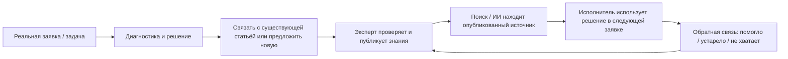
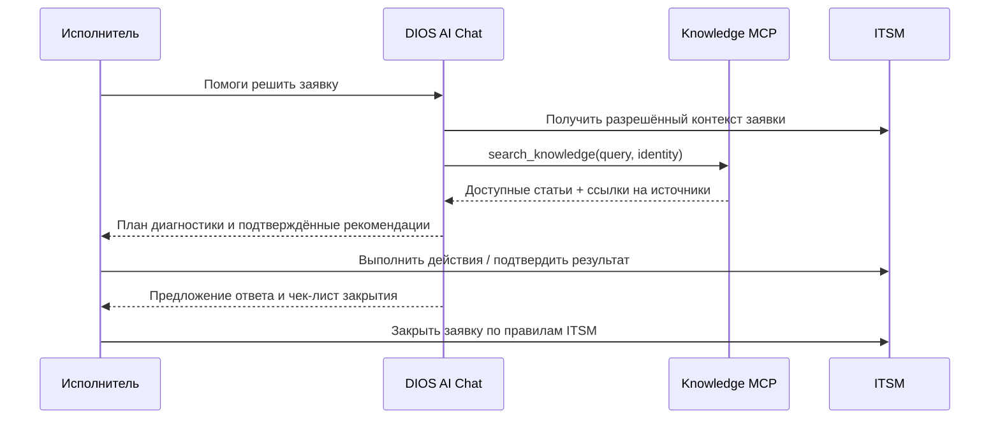

# DIOS Knowledge — продуктовая концепция

> **Тип документа:** бизнес-видение и продуктовые требования высокого уровня.  
> **Статус:** целевая концепция; описанные интеграционные сценарии могут реализовываться поэтапно.  
> **Техническая архитектура:** [`../../architecture.md`](../../architecture.md).

## 1. Зачем DIOS нужна база знаний

В компании ежедневно появляются знания: ответы на обращения, найденные причины инцидентов, инструкции, решения совещаний, исключения из правил, опыт конкретных специалистов. Но часто эти знания **остаются внутри закрытой заявки, переписки, файла или памяти сотрудника**.

В результате следующая команда вновь исследует уже решённую проблему. Сотрудники долго ищут актуальный регламент, новички зависят от коллег, руководители не видят повторяющиеся причины обращений, а ИИ-ассистенту не хватает проверенного контекста, чтобы давать полезные рекомендации.

**DIOS Knowledge превращает разрозненную информацию в управляемую, проверяемую и пригодную для повторного использования корпоративную память.**

Продукт должен обеспечивать три ключевых результата:

1. **Не терять знания.** Сохранять полезные решения в понятном формате, с историей изменений, владельцем, актуальностью и удобным поиском.
2. **Связывать знания с реальной работой.** Показывать, какие статьи помогают решать заявки ITSM, и какие реальные обращения подтверждают или требуют обновления инструкций.
3. **Помогать людям и ИИ решать задачи.** Находить релевантные сведения, предлагать действия и давать ссылки на основания; с разрешения пользователя помогать проводить заявку к закрытию через механизмы ITSM.

## 2. Проблемы, которые решаем

| Сегодня | Что должно измениться |
|---|---|
| Решение осталось в закрытой заявке или чате | Его можно превратить в статью, связать с кейсом и повторно использовать |
| Документы лежат в разных папках и устаревают | Есть единый поиск по опубликованным редакциям и понятный процесс актуализации |
| Для поиска надо знать точное название файла | Поиск понимает естественный запрос, терминологию, сокращения и содержимое изображений |
| Новому специалисту трудно решить типовую заявку | В контексте заявки доступны релевантные инструкции и похожие случаи |
| ИИ отвечает общими словами или выдумывает шаги | ИИ получает только разрешённые знания и указывает конкретные источники |
| Сотрудники повторно исследуют известную проблему | Ранее подтверждённое решение находится до начала длительной диагностики |
| Доступ к материалам сложно контролировать | Видимость знаний соответствует организационным и ресурсным разрешениям |

## 3. Кому и чем полезен продукт

### Исполнитель заявки (поддержка, инженер, эксперт)

Во время работы над обращением получает релевантные статьи, проверенные шаги диагностики, аналогичные случаи и ссылки на действующие регламенты. Может быстро предложить улучшение документации, когда обнаружено новое решение.

### Сотрудник или новый участник команды

Находит инструкции на естественном языке, самостоятельно решает типовые вопросы и меньше зависит от конкретных коллег. Видит **действующую опубликованную версию**, а не случайный черновик или устаревший файл.

### Руководитель и владелец процесса

Понимает, какие знания действительно используются, где повторяются обращения, какие инструкции отсутствуют или устарели и где требуется пересмотреть процесс.

### Редактор/эксперт знаний

Управляет статьями, историей редакций, публикацией, навигацией, доступами и качеством содержания; может превратить удачно решённый кейс в пригодную для повторного использования инструкцию.

### ИИ-ассистент DIOS

Получает через MCP релевантные **разрешённые опубликованные** фрагменты, помогает исполнителю анализировать проблему и формулировать дальнейшие действия. ИИ не получает автоматического права на чужие документы или самостоятельное изменение статуса заявки.

## 4. Главный продуктовый цикл: «Решили → сохранили → нашли → применили»

Важно: Knowledge — **не архив ради хранения**. Полезность статьи определяется тем, смогла ли она помочь в реальной работе, уменьшить повторное исследование проблемы или прояснить процесс.

## 5. Связь базы знаний с реальными заявками DIOS

### 5.1. Из заявки — в знание

Когда обращение успешно решено, исполнитель может:

- привязать к заявке уже существующую статью, которая помогла;
- предложить новую статью по результатам решения;
- дополнить существующую статью найденными уточнениями или ограничениями;
- зафиксировать сведения, которые стоит проверить эксперту перед публикацией.

В перспективе AI Chat может подготовить **черновик статьи** на основании доступной пользователю истории заявки. Эксперт проверяет точность, удаляет лишние персональные или конфиденциальные данные и публикует материал. **Закрытие заявки само по себе не означает автоматическую публикацию в Knowledge.**

### 5.2. Из знания — в заявку

При создании и обработке новой заявки система может предложить:

- статьи, соответствующие теме, симптомам и типу обращения;
- пошаговую инструкцию или чек-лист;
- похожие подтверждённые решения, если интеграция разрешает показывать такие кейсы;
- уточняющие вопросы для дальнейшей диагностики;
- ссылки на регламенты и требования, которые необходимо соблюсти.

Исполнитель должен видеть **почему система предложила материал**: название, подходящий фрагмент, опубликованную версию и ссылку на источник.

### 5.3. Типизированные внешние связи

Ссылка между статьёй и ITSM-объектом несёт полезный бизнес-смысл:

| Связь | Значение |
|---|---|
| `used_to_resolve` | Статья была применена при решении заявки |
| `derived_from` | Знание возникло из конкретного случая |
| `related_to` | Документ относится к процессу, запросу или задаче |
| `needs_update` | Решение выявило необходимость пересмотреть статью |

Названия отношений — **примеры продуктового словаря**, а не уже утверждённая схема БД/API.

Knowledge не должен копировать доменные сущности ITSM и становиться вторым хранилищем заявок. Связь хранит ссылку на тип и идентификатор объекта другого сервиса, а сведения о нём получаются по интеграционному контракту. Доступ к Knowledge-статье **не даёт автоматически** права читать связанную заявку, и наоборот.

## 6. ИИ как помощник по решению и закрытию заявок

ИИ ценен не тем, что просто генерирует текст, а тем, что использует **подтверждённый контекст организации**.

### Ожидаемый сценарий

1. Исполнитель открывает заявку в ITSM и запускает помощь ИИ.
2. ИИ получает разрешённый контекст самой заявки через ITSM и выполняет `search_knowledge` через Knowledge MCP **от имени пользователя**.
3. Поиск возвращает актуальные, опубликованные и доступные статьи с релевантными фрагментами.
4. ИИ предлагает гипотезы, шаги проверки и план действий, объясняя их источниками; при нехватке данных задаёт вопросы вместо выдумывания ответа.
5. Исполнитель выполняет необходимые действия и подтверждает результат.
6. ИИ может предложить текст ответа заявителю, запись о выполненных работах, чек-лист для закрытия и статью для накопления нового опыта.
7. Изменение статуса или закрытие заявки производится через **отдельные инструменты и бизнес-правила ITSM** с необходимыми правами и подтверждением. Сам Knowledge заявок не закрывает.

**Граница доверия:** информация из RAG — источник сведений, а не команда ИИ выполнять произвольные действия. ИИ не должен раскрывать данные чужих организаций, обходить ACL, самостоятельно считать заявку решённой или закрывать её без явно разрешённого процесса.

## 7. Почему качественный поиск — главная функция

**Накопленное знание бесполезно, если его нельзя найти в момент возникновения задачи.**

Поиск должен поддерживать:

- обычный текст и естественные вопросы на русском языке;
- точные термины, названия систем, номера, аббревиатуры и специфичный словарь компании;
- поиск внутри разделов Markdown и таблиц;
- распознавание текста на скриншотах, схемах и изображениях (OCR) с учётом контекста статьи;
- понятные ссылки непосредственно на найденный раздел;
- фильтрацию по пространствам, доступности и другим обоснованным атрибутам;
- подтверждение, что результат относится к **действующей опубликованной редакции**.

Для качества полезно сочетать смысловой и лексический поиск, а не полагаться только на similarity одного embedding. В первой версии приоритет — Markdown и изображения; индексация длинных аудио/видео сознательно отложена.

### Поиск и права доступа

До обращения к поисковому индексу Knowledge вычисляет разрешённую пользователю область. Qdrant ищет внутри неё, а перед возвратом текста система повторно сверяет ACL и факт публикации с PostgreSQL. Это распространяется на Web, MCP и рекомендации в контексте заявок.

Такое правило защищает от попадания недоступных регламентов, фрагментов HR-документов и снятых с публикации материалов в AI-ответы.

## 8. Управление знаниями и доверие к информации

Бизнесу нужен не только поиск, но и понятный жизненный цикл содержания:

- **Черновик** — можно редактировать и обсуждать без раскрытия обычным читателям.
- **Публикация** — эксперт подтверждает версию, которая становится доступной по установленным правам.
- **История изменений** — позволяет понять, что и когда поменялось, и восстановить содержание без потери аудита.
- **Снятие с публикации / архивирование** — устаревшее знание немедленно перестаёт выдаваться читателям; поисковая проекция очищается асинхронно.
- **Обратная связь** — пользователь может сообщить, что статья не помогла или устарела; это формирует очередь улучшений (по мере реализации).

Полезное развитие — редакционный владелец статьи, дата последней проверки актуальности, напоминания о пересмотре, подтверждение экспертами и ссылки на задачи, в которых материал применялся. Это **продуктовые возможности следующего этапа**, а не требования к первой версии Article.

## 9. Граница ответственности подсистем

| Подсистема | Её ответственность |
|---|---|
| **Knowledge** | Статьи, редакции, публикация, навигация, ACL ресурсов, поиск, ссылки на источники |
| **ITSM** | Заявки, исполнители, процессы, статусы, действия и правила закрытия |
| **IAM** | Пользователи, роли, организационное членство и аутентификация |
| **Media Service** | Файлы и версии бинарных объектов |
| **AI Chat** | Диалог, вызовы MCP/tools, генерация рекомендаций и ответов |

Система развивается независимо: интеграции выполняются через явные API/события, а не через прямые зависимости Knowledge от таблиц ITSM.

## 10. Что считать успехом

Метрики не должны быть vanity metrics вроде количества статей без контекста. Оценивать нужно влияние на реальные рабочие процессы.

| Цель | Возможный показатель | Как интерпретировать |
|---|---|---|
| Быстрее находить информацию | Медианное время до полезного результата поиска | Снижение относительно базового периода |
| Выше качество поиска | Recall@K, nDCG@K на размеченных вопросах | Находит ли поиск нужную статью/фрагмент |
| Быстрее решать заявки | Время решения типовых заявок / MTTR | Сравнивать сопоставимые категории и сложность |
| Повторно использовать опыт | Доля решённых заявок со ссылкой на полезную статью | Подтверждённое использование знаний |
| Уменьшать повторное расследование | Повторные диагностики известной проблемы | Снижение при наличии применимой статьи |
| Повышать качество контента | Доля статей с подтверждённой актуальностью, число пометок «устарело» | Управляемое обновление знаний |
| Делать ИИ полезным | Доля AI-подсказок с проверяемыми источниками и положительной оценкой исполнителя | Полезность, а не количество сгенерированных ответов |
| Сохранять безопасность | Подтверждённые случаи раскрытия чужих/непубликованных материалов | Целевое значение — ноль |

**Метрики внедряются поэтапно.** Для выводов об ускорении решения обращений нужен базовый период и сравнение похожих категорий заявок, иначе эффект Knowledge легко переоценить.

## 11. Приоритеты внедрения

### Этап 1 — надёжная база знаний

Пространства, коллекции, Markdown-статьи, неизменяемые редакции, публикация, ACL, первоначальный поиск по опубликованным материалам, стабильные ссылки. Никакой автоматической публикации или автоматического закрытия заявок.

### Этап 2 — поиск и накопление опыта

Hybrid search, OCR изображений, удобный импорт/экспорт, связь статей с реальными заявками, подтверждение полезности и предложения создать/улучшить статью по завершённой работе.

### Этап 3 — AI-assisted work

MCP-инструменты Knowledge для DIOS AI Chat, подсказки в контексте заявок, ответы с проверяемыми источниками, подготовка черновиков решений и статей. Любые действия над заявками — только через авторизованные ITSM-инструменты.

### Возможности позднее

Автоматический контроль устаревших инструкций, аналитика покрытия процессов знаниями, содержательные связи между решениями/регламентами, GraphRAG и полноценная индексация аудио/видео — после подтверждения реальной ценности и затрат.

## 12. Продуктовые принципы

1. **Знания должны помогать выполнять работу**, а не существовать отдельно от неё.
2. **Находить важнее, чем просто сохранять.** Качество поиска — ключевая ценность продукта.
3. **Источники проверяемы.** У ответа есть ссылка на опубликованный материал и конкретный фрагмент.
4. **Человек контролирует публикацию и критические действия.** ИИ помогает, но не подменяет подтверждение результата.
5. **Доступ задаётся правами, а не удобством поиска.** Ни Web, ни MCP, ни AI Chat не могут обходить ACL.
6. **Система не привязана к одной предметной области.** Сначала тесная интеграция с ITSM, затем переиспользование для других подсистем DIOS.
7. **Развиваем продукт по измеримой ценности.** Не внедряем сложную графовую аналитику или мультимодальную инфраструктуру без подтверждённых сценариев.

---

**Краткое позиционирование:** DIOS Knowledge — корпоративная память, которая связывает инструкции и решения с реальными задачами, помогает сотрудникам и ИИ быстрее находить проверенные ответы и превращает опыт закрытых заявок в знания для следующих обращений.
