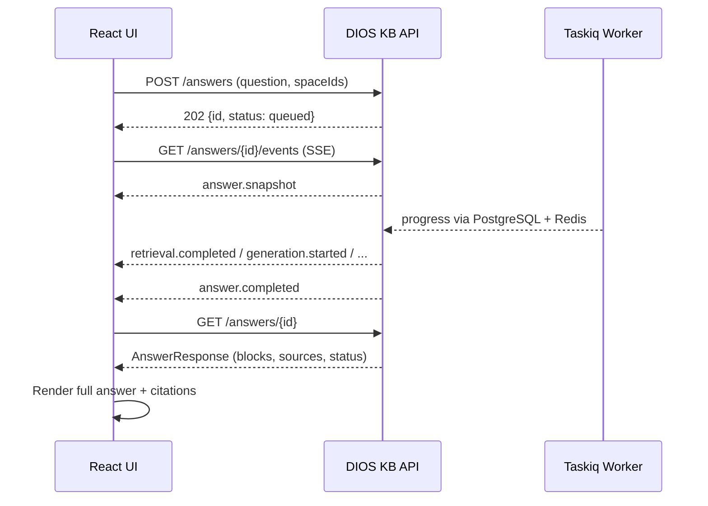

# DIOS KB — Frontend: AI Answers & Knowledge Gaps

> **Назначение:** практический UI/UX-гайд и контракт интеграции с backend DIOS KB.  
> **Статус:** проектная спецификация для реализации; не описание готового интерфейса.  
> **Scope:** фронтенд **самой базы знаний DIOS KB**, не продуктовый портал.  
> **Связанный документ:** `DIOS_KB_AI_ANSWERS_KNOWLEDGE_GAPS_IMPLEMENTATION.md` — backend-архитектура, модели и выполнение.

## 1. Цель интерфейса

**Помочь пользователю быстро найти проверяемый ответ, сохраняя возможность открыть первоисточник, а ответственному редактору — увидеть и исправить проблемы в знаниях.**

В DIOS KB должны быть три связанных, но независимых сценария:

| Сценарий | Где находится | Главная задача |
|---|---|---|
| **Quick Search** | Поисковая панель из любой страницы (`Ctrl/Cmd + K`) | Быстро открыть документ или перейти к полной выдаче |
| **Search Workspace + AI Answers** | Страница `/search` | Найти материалы и по запросу получить обоснованный ответ |
| **Улучшения знаний (Knowledge Gaps)** | Закрытый раздел управления KB | Проверить повторяющиеся проблемы и назначить исправление |

**Принцип:** AI Answers — **часть поиска, не отдельный чат**. Обычные результаты отображаются независимо от LLM и продолжают работать при ошибке генерации.

## 2. UX: Quick Search

По нажатию на строку поиска или `Ctrl/Cmd + K` открывается компактная поисковая панель поверх текущей страницы.

```text
┌───────────────────────────────────────────────────────┐
│ 🔎  Ошибка авторизации 1С                          Esc │
├───────────────────────────────────────────────────────┤
│ Быстрые результаты                                   │
│ ▸ Настройка HTTP-сервисов            Интеграции       │
│ ▸ Диагностика IIS                    Инструкции       │
│ ▸ Права пользователя                 Администрирование│
├───────────────────────────────────────────────────────┤
│ 🔍 Показать все результаты                           │
│ ✦ Получить AI-ответ                                  │
└───────────────────────────────────────────────────────┘
```

**Поведение:**

- Подсказки появляются при вводе через существующий PostgreSQL autocomplete; **LLM для suggestions не используется**.
- Debounce ориентировочно **180–250 мс**, `AbortController` и защита от поздних ответов; значение проверить на реальном API.
- Клавиши `↑/↓` выбирают результат, `Enter` открывает выбранную статью; без выбора — открывает `/search?q=...`.
- Отдельное действие «Получить AI-ответ» открывает страницу поиска **и запускает один AnswerRun**, только после явного действия пользователя.
- `Esc` закрывает overlay, фокус возвращается к элементу, открывшему поиск.
- Учитывать `aria-combobox`, `listbox`, focus management, экранные читалки и `prefers-reduced-motion`.
- Не выполнять поиск на пустой строке и не показывать пользователю чужие/неопубликованные статьи.

## 3. UX: Search Workspace и AI Answers

Основная страница поиска — единый рабочий экран:

```text
Поиск: [Как устранить ошибку авторизации 1С?                 ]
[Все доступные пространства ▾] [По релевантности ▾]

┌─────────────────────────────────┬──────────────────────────┐
│ ✦ AI Answers                    │ Источники                │
│                                 │ [1] Настройка HTTP…      │
│ Готовый ответ с шагами [1] [2]  │ [2] Права пользователя   │
│                                 │                          │
│ [Копировать] [👍] [👎]           │                          │
└─────────────────────────────────┴──────────────────────────┘

Результаты поиска
▸ Настройка HTTP-сервисов 1С     Интеграции / Аутентификация
▸ Проверка прав пользователей    Администрирование
```

### Правила компоновки

- **AI-ответ + источники рядом**, обычные результаты — ниже. Не прятать статьи за вкладкой «AI».
- Читать текст комфортно в колонке примерно **680–800 px**; панель источников **280–320 px**, размеры адаптивные.
- На мобильном — одна колонка, источники в раскрывающемся блоке или drawer.
- Использовать спокойную типографику и нейтральные поверхности; без больших градиентов, искусственных «AI-эффектов» и постоянного skeleton.
- Фильтры — компактные chips, только для реально поддерживаемых backend-полей.
- При переходе к источнику открывать **конкретный раздел** статьи (`anchor`), а не просто главную страницу документа.
- Обычный поиск поддерживает пустую выдачу, ошибки, фильтры, пагинацию и прямые ссылки независимо от AnswerRun.

### URL как источник состояния поиска

Рекомендуемый вид: `/search?q=...&spaceIds=...`.

В URL допустимо держать параметры поиска, но **не access token**. Для чувствительных корпоративных вопросов учесть риск утечек поисковой строки через стороннюю аналитику и логи. `answer_id` — отдельный идентификатор запуска; его можно использовать для восстановления результата после навигации.

## 4. Прогресс AI Answers: живой UX без token streaming

**Решение:** показывать только настоящие этапы backend, а готовый ответ — **целиком** после проверки citations и сохранения.

Пример пользовательских сообщений:

1. **Запрос принят**.
2. **Ищем материалы** — только после фактического начала retrieval.
3. **Найдено 10 результатов** — число **после** ACL-проверки; выбрано 4 источника.
4. **Формируем ответ** — начат LLM inference.
5. **Проверяем ссылки и сохраняем результат**.
6. **Ответ готов** — заменить progress на контент.

В компактном UI показывать текущий этап и максимум 1–2 предыдущих. **Не придумывать проценты** и не изменять состояния по таймеру.

| Backend `status` | Что отображает frontend |
|---|---|
| `queued` | «Запрос принят» |
| `running` + `retrieval` | «Ищем материалы» |
| `running` + `context_preparation` | «Подготавливаем источники» |
| `running` + `generation` | «Формируем ответ» |
| `running` + `validation` | «Проверяем результат» |
| `completed` | Загрузить и показать готовый ответ |
| `failed` | Понятная ошибка + действие «Попробовать снова» |
| `cancelled` | «Генерация отменена» — только если появится API отмены |

`connection = disconnected` **не равно** `status = failed`: SSE мог оборваться, а Taskiq продолжает генерацию. В этом случае показывать «Восстанавливаем соединение», а не запускать новый платный ответ.

## 5. Контракт интеграции с backend

Основные endpoint согласованы с backend RFC:

| Метод | Endpoint | Использование |
|---|---|---|
| `GET` | существующий API suggestions | Quick Search |
| `GET` | существующий API search | Результаты и фильтры |
| `POST` | `/api/service/v1/answers` | Создать `AnswerRun`, получить `202 + id` |
| `GET` | `/api/service/v1/answers/{id}/events` | SSE: progress и terminal event |
| `GET` | `/api/service/v1/answers/{id}` | Получить актуальное состояние и готовый ответ |
| `PUT` | `/api/service/v1/answers/{id}/feedback` | Сохранить/изменить собственную оценку |
| `GET` | `/api/service/v1/knowledge-gaps` | Список доступных редактору проблем |
| `GET` | `/api/service/v1/knowledge-gaps/{id}` | Детали, классификация, разрешённые evidence |
| `PATCH/POST` | `/api/service/v1/knowledge-gaps/{id}/...` | Triage, assign, start, resolve, dismiss, reopen |

### Основной flow



### Критичные правила

- **`POST` выполняется один раз при нажатии**, а не в `useEffect` при изменении query или монтировании компонента.
- При перезагрузке страницы восстанавливать **существующий run** через `GET`, а не создавать новый.
- На `answer.completed` выполнить `GET` и отобразить **финальный** `AnswerResponse`, не собирать Markdown из SSE.
- Дубли и события не по порядку игнорировать по монотонному `sequence`.
- При разрыве SSE сначала запросить snapshot и переподключиться; `answer.completed` мог уже произойти.
- `EventSource` нативно **не поддерживает произвольный `Authorization: Bearer`**. Для bearer-auth использовать fetch-based SSE transport либо авторизованный same-origin BFF с HttpOnly cookie.
- Не помещать JWT в query string, не писать bearer token в логи.
- Backend **всегда** проверяет права на run/источники/feedback; скрытые кнопки на frontend не являются авторизацией.
- При смене организации или пользователя **сбросить** search/answer/source caches и закрыть SSE.

### Source references

Ответ приходит структурированным: `AnswerBlock[]` (`markdown`, `citations`) и `AnswerSource[]` (`id`, `title`, `excerpt`, `articleId`, `revisionId`, `chunkId`, `anchor`, `url`).

- Для цитат построить `Map<sourceId, AnswerSource>` и рендерить отдельный компонент `AnswerCitation`.
- По клику на `[1]` показывать preview подтверждающего фрагмента, затем возможность открыть статью в нужном разделе.
- Не доверять ссылкам, произвольно созданным LLM внутри Markdown; источники и URL приходят от backend.
- Рендерить Markdown с безопасными правилами; не вставлять непроверенный HTML через `dangerouslySetInnerHTML`.
- Для сохранённого ответа после изменения прав сервер может отказаться выдавать фрагмент; frontend обязан очистить старый контент и показать корректное состояние доступа.

## 6. Рекомендуемая организация frontend-кода

Не требуется вводить новый state manager или переносить приложение на Next.js. Использовать **текущий стек самой KB** (React/TypeScript и существующую UI-систему), общий HTTP `BackendCaller` и текущие conventions проекта.

```text
src/
├── pages/
│   ├── search/                      # SearchPage
│   └── knowledge-improvements/     # Inbox + details
├── widgets/
│   ├── quick-search/               # Глобальный overlay
│   ├── search-workspace/           # Страница выдачи
│   ├── answer-panel/               # CTA / progress / answer / error
│   └── improvement-inbox/          # Рабочая очередь редактора
├── features/
│   ├── search-articles/            # Search state, filters
│   ├── answer-generation/          # AnswerRunStore, SSE transport
│   ├── answer-feedback/            # PUT feedback
│   └── manage-knowledge-gap/       # Editor actions
├── entities/
│   ├── article/
│   ├── answer/                     # AnswerContent, Citation, SourcePreview
│   └── knowledge-gap/             # Gap item, types
└── shared/
    ├── api/                        # BackendCaller
    └── ui/                         # Общий DIOS UI Kit
```

Это **ориентир**, не инструкция создавать отдельные папки и stores для каждого компонента. Если модуль небольшой, оставить его компактным.

### Разделение состояния

| Тип | Где хранить |
|---|---|
| Query, фильтры, сортировка | URL/router state |
| Search results и suggestions | Search store / существующий серверный кеш |
| AnswerRun ID, progress, response, connection state | `AnswerRunStore` |
| Открыт ли drawer, активная подсказка, локальный выбор feedback | Local component state |
| KnowledgeGap list и конкретная редакторская задача | Независимые stores / API state |

**Не складывать всё в один `SearchStore`.** Состояние SSE-соединения должно быть отдельным от серверного статуса run.

## 7. Feedback: минимальное трение

Под **готовым** ответом: «Помог ли этот ответ?» — **👍 / 👎**.

- `👍`: отправить `PUT` без дополнительных вопросов.
- `👎`: предложить необязательную причину: `no_solution`, `incorrect`, `incomplete`, `outdated`, `irrelevant_sources`, `other`; при желании короткий комментарий.
- Одна актуальная оценка пользователя на один ответ, можно изменить через повторный `PUT`.
- Допустим optimistic UI с rollback при ошибке.
- Негативная оценка **не создаёт KnowledgeGap прямо с frontend**; backend анализирует signals асинхронно.
- Не делать обязательный длинный опрос и не блокировать пользователю доступ к источникам после оценки.

## 8. Knowledge Gaps: интерфейс «Улучшения знаний»

Не использовать техническое название `Knowledge Gaps` как главное название раздела. Рекомендуется **«Управление знаниями → Улучшения»**.

### Inbox (список)

На первой странице редактор должен понять: **какая проблема возникла, почему она предложена, насколько важна и кто её исправит**.

```text
Улучшения знаний
[Ожидают разбора: 12] [В работе: 5] [Решены: 24]
[Все категории ▾] [Пространство ▾] [Ответственный ▾]

Ошибка авторизации 1С
Вероятно неполная инструкция  ·  8 сигналов  ·  Интеграции
Рекомендация: дополнить существующую статью

Не находится документация REST API
Вероятно проблема находимости  ·  5 сигналов  ·  API
Рекомендация: улучшить заголовок и поисковые термины
```

*Цифры и примеры — демонстрационные.*

- Не строить сразу тяжёлый dashboard с множеством графиков.
- Карточка показывает **тип проблемы + основание + рекомендуемое действие**, а не сырой output LLM.
- Фильтры: статус, категория, пространство, ответственный; списки и totals — **строго по правам backend**.
- Для `space_id = null` — отдельная организационная очередь triage для уполномоченных владельцев знаний.

### Детали Gap

Две области: слева описание проблемы, основания и связанные статьи; справа статус, категория, ответственный и действия.

| Состояние | Возможные действия |
|---|---|
| `open / needs_triage` | Классифицировать, назначить, отклонить |
| `open / classified` | Взять в работу, изменить ответственного |
| `in_progress` | Перейти к статье, завершить, отклонить |
| `resolved` / `dismissed` | Просмотреть итог и при наличии права переоткрыть |

- Для редакторских действий **не делать агрессивный optimistic update**: возможен `409 Conflict`, если задачу изменил другой редактор.
- Если редактор нажал «Улучшить статью», открывать **существующий редактор KB**, а не отдельную AI-страницу.
- Связанные вопросы/сигналы показывать в агрегированном виде. Открытие первичных evidence — только при отдельном праве доступа.
- Право видеть карточку gap **не означает** право читать все источники, на которых основано предложение.
- AI-соавтор инструкций — **следующий этап**: контекстная панель в редакторе, уточняющие вопросы, черновик, ручная проверка и публикация.

## 9. Дизайн, доступность и надёжность

**Визуальный подход:** спокойный, минималистичный интерфейс; качественная типографика, компактные chips, читаемые фрагменты, аккуратный focus state. Допустимы лёгкие переходы и выделение активного этапа. Не использовать таймер для «симуляции поиска», ненужные неоновые эффекты или длинные thinking traces.

**Что обязательно протестировать:**

| Проверка | Ожидаемое поведение |
|---|---|
| Быстрый ввод и удаление query | Нет старых suggestions поверх новых |
| `Ctrl/Cmd + K`, клавиатура, Esc | Предсказуемый focus и выбор результата |
| Повторный render или StrictMode | Не создаётся второй платный AnswerRun |
| Разрыв SSE | Переподключение и восстановление snapshot без нового POST |
| Завершение быстрее подключения | `GET`/SSE snapshot корректно показывают готовый результат |
| Дубликаты/потеря сообщений | Проверка `sequence`; UI не откатывается назад |
| Ошибка генерации | Обычные результаты остаются доступны |
| Отзыв READ / смена организации | Скрывается прежний защищённый контент и очищается кеш |
| Неверная citation | Нет кликабельной «доверенной» ссылки на неизвестный источник |
| Негативный feedback | Сохраняется один отзыв, без автоматического создания gap |
| Два редактора меняют gap | Отображение актуального состояния, обработка конфликта |
| Мобильное устройство / screen reader | Источники доступны и без hover, клавиатура работает |

**Метрики UX:** latency suggestions, search-to-open time, answer start-to-ready, доля прерванных просмотров, процент проверок источников, helpful feedback rate, время triage gap. Не путать отсутствие feedback с успешным решением.

## 10. Рекомендуемый порядок реализации

1. **Quick Search и Search Workspace:** autocomplete, keyboard UX, URL-driven search, фильтры, карточки статей и переходы к секциям.
2. **AnswerRun + SSE:** `POST`, подписка, реальный прогресс, reconnect, готовый ответ целиком.
3. **Sources и error states:** citations рядом с утверждениями, preview, недостаточные доказательства, сбои, корректное изменение ACL.
4. **Feedback:** thumbs up/down, причины, `PUT`, повторная оценка.
5. **Knowledge Improvements:** inbox, triage, owner, статусы, разрешённые доказательства и действия редактора.
6. **Позже:** AI-assisted authoring внутри существующего редактора статьи.

## Итоговые принципы

**Search-first, answer-on-demand, evidence-first.** AI не блокирует обычную выдачу, не создаётся автоматически на каждом вводе и не скрывает первоисточники.

**Одна пользовательская генерация — один `AnswerRun`.** SSE сообщает о состоянии, а не управляет жизненным циклом операции. После reconnect загружается тот же результат, не создаётся новый запрос к LLM.

**Knowledge Gaps — рабочая очередь для владельцев знаний.** Feedback только передаёт сигнал; истинную причину определяет backend, а решение о публикации принимает уполномоченный человек.
